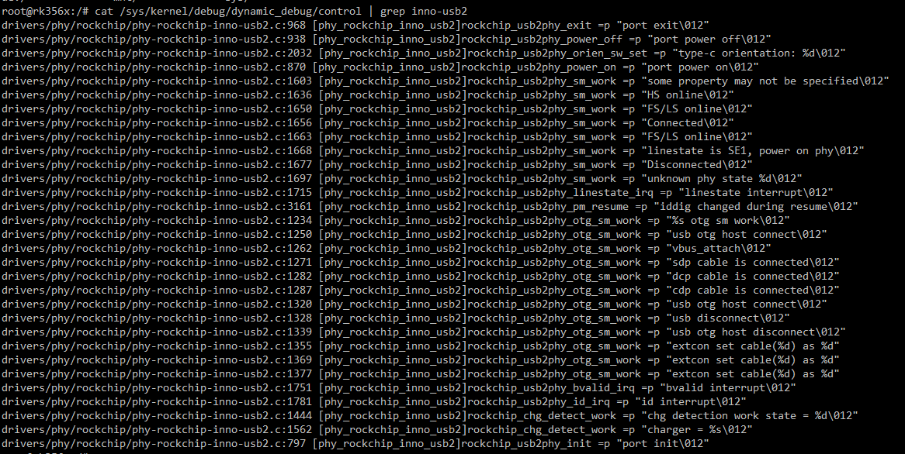

# 开启dev_dbg方法

## 简介

在 Linux 内核开发和调试过程中，调试日志是定位问题的重要工具。`dev_dbg` 是内核中常用的调试接口，但默认情况下其输出是关闭的，开发者需要根据需求启用相关功能。本篇文章将详细介绍如何通过动态调试机制启用 `dev_dbg`，以及在特定情况下通过其他方式实现调试信息输出。

## 通过动态调试

动态调试（**Dynamic debug**）是 Linux 内核提供的一种机制，可以在运行时启用或禁用调试日志。

### 确保内核启用了动态调试支持

编译内核时，确保以下配置项被启用：

```jsx
CONFIG_DYNAMIC_DEBUG=y
```

### 在运行时启用 `dev_dbg`

通过动态调试接口，可以有选择性地启用调试信息。

1. 查看支持动态调试的接口：
   
    ```bash
    cat /sys/kernel/debug/dynamic_debug/control
    ```
    
    该接口可以打印所有支持动态调试的驱动和打印语句，信息比较多，可以用 grep 进行过滤，下面以 phy-rockchip-inno-usb2.c 这个驱动为例，读出来的是 phy-rockchip-inno-usb2.c 驱动里面所有的 dev_dbg 语句，每一行的信息内容依次是：
    
    驱动文件路径+行数+模块名+函数+日志信息。
    
    
    
2. 启用指定模块的 `dev_dbg`：
   
    ```bash
    echo 'module <module_name> +p' > /sys/kernel/debug/dynamic_debug/control
    ```
    
    该语句可以打印指定模块所有的 `dev_dbg`，从前面读到的支持动态调试的接口就可以查询到所有支持动态调试的驱动对应的模块信息，还是以 phy-rockchip-inno-usb2.c 为例，它的模块名字为 phy_rockchip_inno_usb2，因此这里实际执行的语句是：
    
    ```bash
    echo 'module phy_rockchip_inno_usb2 +p' > /sys/kernel/debug/dynamic_debug/control
    ```
    
3. 启用指定文件的 `dev_dbg`：
   
    ```bash
    echo 'file <filename> +p' > /sys/kernel/debug/dynamic_debug/control
    ```
    
    该语句可以打印指定驱动文件内所有的 `dev_dbg`，以 phy-rockchip-inno-usb2.c 为例，这里实际执行的语句是：
    
    ```bash
    echo 'file phy-rockchip-inno-usb2.c +p' > /sys/kernel/debug/dynamic_debug/control
    ```
    
4. 启用指定函数的 `dev_dbg`：
   
    ```bash
    echo 'func func_name +p' > /sys/kernel/debug/dynamic_debug/control
    ```
    
    该语句可以打印指定驱动里面某个函数的 `dev_dbg`，从前面读到的支持动态调试的接口就可以查询到所有支持动态调试的驱动里面的函数信息，以 rockchip_usb2phy_otg_sm_work 这个函数为例，这里实际执行的语句是：
    
    ```bash
    echo 'func rockchip_usb2phy_otg_sm_work +p' > /sys/kernel/debug/dynamic_debug/control
    ```
    
5. 启用所有的动态调试信息：
   
    ```bash
    echo 'func * +p' > /sys/kernel/debug/dynamic_debug/control
    ```
    
    该语句可以打印系统所有驱动的动态调试信息，执行该语句之后，将会有大量的日志。
    

### 观察调试信息

动态调试启用后，可以通过 `dmesg`查看内核日志，如果你是在板子的调试串口上执行，可以调整 kernel 打印等级，直接在调试串口中看到动态调试的日志信息，调整 kernel 打印等级为8，可以执行：

```bash
echo 8 > /proc/sys/kernel/printk
```

### 注意事项

1. 动态调试需要挂载 debugfs，请确保 `debugfs` 文件系统已挂载：
   
    ```c
    mount -t debugfs none /sys/kernel/debug
    ```
    
2. 调试信息会影响系统性能，启用大量调试日志可能对系统性能有较大影响。

## 添加DEBUG宏

如果动态调试无法满足需求，可以直接修改驱动代码，在驱动文件的首行添加DEBUG宏，如：

```c
diff --git a/drivers/phy/rockchip/phy-rockchip-inno-usb2.c b/drivers/phy/rockchip/phy-rockchip-inno-usb2.c
index 1a56480e13b8..49b8e373c92f 100644
--- a/drivers/phy/rockchip/phy-rockchip-inno-usb2.c
+++ b/drivers/phy/rockchip/phy-rockchip-inno-usb2.c
@@ -5,6 +5,7 @@
  * Copyright (C) 2016 Fuzhou Rockchip Electronics Co., Ltd
  */
 
+#define DEBUG
 #include <linux/clk.h>
 #include <linux/clk-provider.h>
 #include <linux/delay.h>
```

注意事项

1. 需要将 `CONFIG_DYNAMIC_DEBUG` 启用。
2. 必须把 DEBUG 宏放到驱动首行，放到头文件之后会导致不生效。
3. 如果要在调试串口中看到日志，需要调整 kernel 打印等级，如：
   
    `echo 8 > /proc/sys/kernel/printk`
    

## 重定义dev_dbg

前面的方法都需要修改 kernel 的打印等级和 CONFIG_DYNAMIC_DEBUG，如果想要不修改 kernel 打印等级和打开动态调试功能，又希望直接在调试串口上看到日志，可以直接给 dev_dbg 做一个重定义，比如把它重定义为 dev_info，具体修改如：

```c
diff --git a/drivers/phy/rockchip/phy-rockchip-inno-usb2.c b/drivers/phy/rockchip/phy-rockchip-inno-usb2.c
index 1a56480e13b8..90b426bad5fb 100644
--- a/drivers/phy/rockchip/phy-rockchip-inno-usb2.c
+++ b/drivers/phy/rockchip/phy-rockchip-inno-usb2.c
@@ -40,6 +40,9 @@
 #define BYPASS_SCHEDULE_DELAY  (2 * HZ)
 #define FILTER_COUNTER         0xF4240
 
+#undef dev_dbg
+#define dev_dbg dev_info
+
 struct rockchip_usb2phy;
 
 enum rockchip_usb2phy_port_id {
@@ -4244,6 +4247,9 @@ static struct platform_driver rockchip_usb2phy_driver = {
 };
 module_platform_driver(rockchip_usb2phy_driver);
 
+#undef dev_dbg
+#define dev_dbg(dev, format, arg...)  do{}while(0)
+
 MODULE_DESCRIPTION("Rockchip USB2.0 PHY driver");
 MODULE_LICENSE("GPL v2");
```

## 小结

动态调试为 Linux 内核开发者提供了强大的运行时调试功能，支持按需启用日志输出，避免因全局打印调试信息而导致的性能问题。此外，通过添加 DEBUG 宏或重定义 `dev_dbg`，开发者可以在更受限的环境中灵活调整调试输出。合理配置调试机制，将有助于提升内核开发的效率和问题定位的准确性。