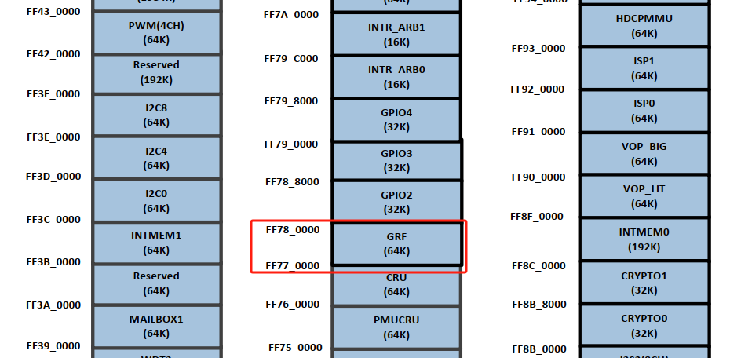

# RK平台操作GPIO的两种方法

在嵌入式开发调试过程中，操作 GPIO 是一个至关重要的技能。通过操作 GPIO，我们可以控制外部设备，比如开关LED灯、开关模块电源、复位外设等。本文将分享两种在 RK 平台上通过 ADB 或者调试串口就能操作 GPIO 的方法。

### **直接操作寄存器**

这种方式可以直接通过操作 CPU 的寄存器，精准控制每一个 GPIO 引脚的状态，简单直接。缺点就是需要查阅芯片手册，并且要求板子上有 IO 指令，IO 指令的使用方法可以看前面的文章。

下面以拉高 RK3399 的 GPIO2_D3 为例来说明：

- 查GRF基址

从 RK3399 的 TRM 手册 Address Mapping 章节获得 GRF 基址为：0xFF770000：



- 查IOMUX偏移址

IOMUX 管理每个 GPIO 口的功能复用，从 GRF Register Description 章节找到 GRF_GPIO2D_IOMUX 偏移地址为 0x0000E00C：


- 设置 IOMUX 寄存器

找到 IOMUX 寄存器的描述：


可以看到 bit[7:6] 设置为 2’b00 的时候，该 GPIO 为 GPIO 功能，由于 bit[31:16] 为写允许位，bit[7:6] 对应的写允许位 bit[23:22] 为2’b11，因此实际写入的寄存器值为0x00C00000：

```jsx
io -4 0xFF77E00C 0x00C00000
```

- 查 PU/PD 偏移址

PU/PD 控制每个 GPIO 口的拉低和拉高，从 GRF Register Description 章节找到 GRF_GPIO2D_P 偏移地址为 0x0000E04C：


- 设置 PU/PD 寄存器

找到 PU/PD 寄存器的描述：


可以看到 bit[7:6] 设置为 2’b11 的时候，该 GPIO 是拉高状态(pull-up)，由于 bit[31:16] 为写允许位，bit[7:6] 对应的写允许位 bit[23:22] 为2’b11，因此实际写入的寄存器值为0x00C000C0：

```jsx
io -4 0xFF77E04C 0x00C000C0
```

### **通过 Sysfs 接口**

Sysfs 接口是 kernel 给用户空间提供的接口，可以把设备和驱动程序从内核输出到用户空间，也可以用来对设备和驱动程序做设置，因此也为 GPIO 提供了简便的操作方式。通过文件系统对 GPIO 进行配置和控制，可以避免直接操作寄存器的复杂性。但是，要通过 Sysfs 接口来操作，前提是系统没有使用到对应的 GPIO 口，设备的 dts 文件也没有对该 GPIO 口有定义，否则可能会导致操作失败。

下面同样以拉高 RK3399 的 GPIO2_D3 为例来说明：

- 计算 GPIO 编号

GPIO 的编号计算公式为：GPIO2_D3=2x32+(D-A)x8+3=2x32+3x8+3=91，因此 GPIO2_D3 的编号是 91。

- 导出GPIO

```bash
echo 91 > /sys/class/gpio/export
```

- 配置为输出模式

```bash
echo "out" > /sys/class/gpio/gpio91/direction
```

- 设置输出值

```bash
echo "1" > /sys/class/gpio/gpio91/value  # 高电平
echo "0" > /sys/class/gpio/gpio91/value  # 低电平
```

Sysfs 接口适合开发者快速上手 GPIO 控制，无需复杂的底层操作，适合简单的项目或测试使用。

### 总结

在 RK 平台上操作 GPIO 有多种方法，以上是个人在 RK 平台开发调试过程经常用到的方法，在项目开发中可以根据现场条件选择最适合的方式。

**欢迎关注公众号“我的RK随记”，获取更多技术分享！**