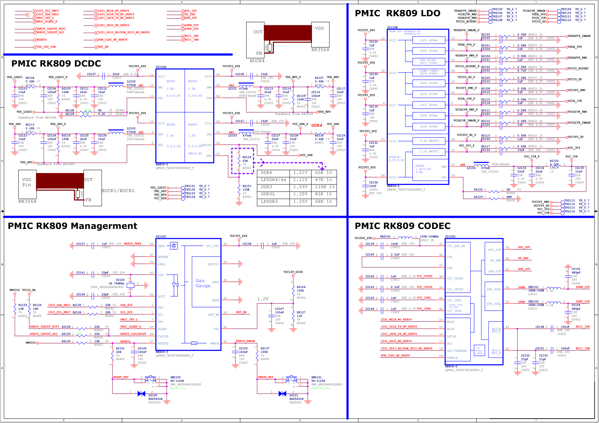

在嵌入式系统开发中，PMIC（电源管理集成电路）作为系统的"动力核心"，其设计直接决定了系统能否正常启动和稳定运行。不当的 PMIC 设计甚至可能导致硬件损坏。因此，在项目初期对 PMIC 的软硬件设计进行充分验证至关重要。
RK 平台在推出各系列 SoC 处理器的同时，配套开发了多款 PMIC 芯片。这些 PMIC 旨在适配不同型号的处理器，并满足多样化应用场景的供电需求。本文将系统梳理RK平台主流 PMIC 产品线，并分享实用的软件调试技巧。
## 了解PMIC
**PMIC（Power Management Integrated Circuit，电源管理集成电路）** 是一种专门用于管理电子设备电源的芯片，负责将输入电源转换为不同电压和电流，供给处理器、内存、传感器等各个模块使用。
### PMIC关键特性
1. **多路电源输出**
    - 包含DC-DC和LDO两种主要类型，为不同模块提供合适的电压（如1.8V、3.3V、5V等）。
2. **动态电压调节**
    - 可根据 CPU/GPU 负载动态调整电压，优化功耗（如高性能模式 vs 低功耗模式）。
3. **低功耗管理**
    - 支持多种电源状态：休眠（Sleep）、关机（Shutdown）、待机（Standby）等。
4. **充电管理**
    - 部分 PMIC 集成锂电池充电管理，支持快充、涓流充电、反向充电（OTG）等功能。
5. **保护机制**
    - 过压保护、欠压保护、过流保护等多重保护功能。
6. **集成额外功能**
    - 部分 PMIC 还集成 RTC（实时时钟）、复位电路、音频 CODEC、GPIO 控制等外围功能。
### 电源转换技术详解
**DC-DC转换器**：
- 优点：输入输出压差大时效率高（80-95%），适合大电流负载
- 缺点：存在较大纹波，成本较高
- 工作模式：
    - PWM模式：纹波小，瞬态响应好，但效率较低
    - PFM模式：效率高，但负载能力较差
**LDO稳压器**：
- 优点：电路简单，成本低，输出纹波小
- 缺点：输入输出压差大时效率低（30-60%）
- 优化建议：将LDO输入接到DC-DC输出端以提高效率
**PLDO**：
- 传统LDO，工作电压范围：2.0V-5.5V
**NLDO**：
- 支持低压工作（如1.1V输入，0.9V输出），功耗更低

## RK 平台的 PMIC
RK 平台 PMIC 主要分为两大系列：
- **RK80X 系列**：无电池充电管理，适用于固定电源供电的设备（如机顶盒、开发板）。
- **RK81X 系列**：集成电池充电管理功能，适用于移动设备等需电池供电的场景。
### RK80X 系列（无充电管理）
| **型号** | **输入电压**  | **核心特性**                        | **电源通道配置**                    | **典型适配 SOC**  |
| ------ | --------- | ------------------------------- | ----------------------------- | ------------- |
| RK805  | 2.7V~5.5V | 1个RTC；可调上电时序                    | 4 路 DCDC；3 路 LDO              | RK3288/RK3326 |
| RK806  | 2.7V~5.5V | 支持 I2C/SPI 双通信及双 PMIC 协同；可调上电时序 | 10 路 DCDC；5 路 NLDO；6 路 PLDO   | RK3588/RK3568 |
| RK808  | 2.7V~5.5V | 1个RTC；可调上电时序                    | 4 路 DCDC；8 路 LDO；2 路开关 SWITCH | RK3399/RK3566 |
| RK809  | 2.7V~5.5V | 1个 RTC；1个 高性能CODEC；可调上电时序       | 5 路 DCDC；9 路 LDO；2 路开关 SWITCH | RK3288/RK3308 
### RK81X 系列（含充电管理）
| **型号** | **输入电压**                         | **核心特性**                                        | **电源通道配置**                                                    | **典型适配 SOC**  |
| ------ | -------------------------------- | ----------------------------------------------- | ------------------------------------------------------------- | ------------- |
| RK816  | USB：3.8V~5.5V  <br>BAT：2.7V~4.5V | 1 个 RTC；可调上电时序；集成开关充电、智能功率路径管理、库仑计等功能           | 4 路 DCDC；1 路升压BOOST、6 路 LDO、1路 OTG 输出                         | RK3288/RK3326 |
| RK817  | USB：3.8V~5.5V  <br>BAT：2.7V~5.5V | 1个 RTC；1个高性能CODEC；可调上电时序；集成开关充电、智能功率路径管理、库仑计等功能 | 4 路 DCDC、9 路 LDO、1 路升压BOOST、1 路开关 SWITCH                      | RK3399/RK3566 |
| RK818  | USB：3.8V~6V  <br>BAT：2.7V~4.5V   | 1 个 RTC；可调上电时序；集成开关充电、智能功率路径管理、库仑计等功能           | 4 路 DCDC；1路升压BOOST；9 路 LDO；1路开关 SWITCH；一路 HDIM5V 输出；一路 OTG 输出 | RK3588/RK3568 |

## PMIC软件配置指南
软件配置必须与硬件设计严格匹配，核心是通过设备树（DTS）配置 PMIC 的 I2C 挂载和电源通道参数。
### 配置示例：RK3568 开发板（RK809）

原理图中清晰呈现了 RK809 的电源输出配置，包括 4 路 DCDC、9 路 LDO、2 路 SWOUT 及 1 路 SW。每一路输出均标注了对应的电源网络名称，这一名称与软件设备树（DTS）中的配置项存在严格的一一对应关系。
各路输出电压需依据硬件设计的实际需求进行设定，部分电压值可直接从电源网络名称中直观获取（例如名称中包含 “1v8”“3v3” 等标识时，可快速知晓对应电压为 1.8V、3.3V）。这种硬件标识与软件配置的对应关系，是确保电源输出匹配系统需求的关键前提。
下面摘录部分的dts配置进行说明。
```c
&i2c0 {
    status = "okay";
    rk809: pmic@20 {
        compatible = "rockchip,rk809";  // 驱动匹配标识（不可修改）
        reg = <0x20>;                   // I2C地址（不可修改）
        interrupt-parent = <&gpio0>;    // 中断父节点
        interrupts = <3 IRQ_TYPE_LEVEL_LOW>;  // 中断引脚及触发方式

        // 电源通道配置（以DCDC_REG1为例）
        regulators {
            vdd_logic: DCDC_REG1 {
                regulator-always-on;             // 运行时不允许关闭
                regulator-boot-on;               // 注册时自动使能
                regulator-min-microvolt = <500000>;  // 最小可调电压
                regulator-max-microvolt = <1350000>; // 最大可调电压
                regulator-init-microvolt = <900000>; // uboot初始化电压
                regulator-name = "vdd_logic";    // 电源名称（需与硬件一致）
            };
            // 其他通道配置（略）
        };
    };
};
```
#### 配置要点
1. **I2C 挂载**：PMIC 节点需挂载到对应 I2C 总线下，`status = "okay"`启用。
2. **固定参数**：`compatible`、`reg`、`rockchip,system-power-controller`等为驱动必需，不可修改。
3. **电源通道**：
    - `regulator-name`需与硬件原理图一致（用于`regulator_get`接口匹配）。
    - `regulator-always-on`/`regulator-boot-on`控制电源使能策略。
    - 电压参数（`min/max/init-microvolt`）需符合硬件需求。
## 调试
### 内置调试接口
PMIC 的驱动内置有调试接口`/sys/rk8xx/rk8xx_dbg`：
读寄存器：  `echo r [addr] > /sys/rk8xx/rk8xx_dbg`
写寄存器：  `echo w [addr] [value] > /sys/rk8xx/rk8xx_dbg`
### 使用i2c-tool
使用`i2c-tools`直接读写 PMIC 寄存器（参考《[RK平台使用i2c-tools调试](https://mp.weixin.qq.com/s/IeUemt-Rb7LTz4XHCB4Gaw)》），验证电压调节、开关控制等功能。
## 总结
RK 平台的 PMIC 型号丰富多样，能满足不同场景的需求。在实际项目开发中，建议优先采用官方参考设计中的 PMIC 型号，这不仅能降低软件开发的适配成本，还能有效规避潜在的硬件兼容性问题。确保 PMIC 的软件配置参数与硬件设计完全匹配，这是实现系统稳定性的关键因素。