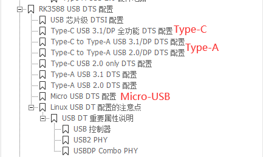

## 简介

ADB（Android Debug Bridge，安卓调试桥）是 Android 提供的一种命令行工具，用于开发者与 Android 设备进行交互。通过 ADB，可以连接 Android 手机、平板或模拟器，执行各种调试、操作和数据传输任务。

RK 平台，所有 Android 系统设备都支持 ADB 功能，为了调试方便，RK 平台的 Linux 系统也默认支持 ADB，其源码是从 Android 移植过来的。

本文档主要介绍开发者在项目开发过程中遇到 ADB 不识别时的排查思路和步骤。

## 基本问题排查步骤

RK发布的大部分 SDK 默认是支持开发板通过 ADB 连接 PC 的，如果开发板通过 USB 线连接 PC 后，PC 识别不到 ADB 设备，需要先确认几个问题：

1. 硬件连接是否正确？

   ADB 功能需要开发板的 OTG 口连接到 PC，一般与烧录固件的 USB 口是同一个。

2. 硬件是否正常？

   开发板通过 USB 线连接 PC，板子进入 loader 模式或者 maskrom 模式，确认 PC 是否能正常识别？如果能正常识别说明 USB 接口的数据线部分硬件连接是正常的。

3. 板子是否能正常开机？

   可以通过开发板的调试串口看开机日志，开发板开机后可以通过调试串口能执行 shell 指令说明系统已经正常开机，如果板子不能正常开机，先排查系统问题，再来调试 USB。

4. PC 是否有安装 USB 驱动和 ADB 工具？

   PC 如果是第一次连接 RK 平台开发板，需要安装 RK 平台的 USB 驱动，Windows PC 的 USB 驱动在 SDK 中可以找到，Android SDK 在 RKTools 目录下面，Linux SDK 在 tools 目录下面，驱动安装包名字为 DriverAssitant_vx.x.zip，Linux PC 不需要安装 USB 驱动。Windows PC 的 ADB 工具可以上网找安装教程，Linux PC 如果是 ubuntu 系统可以用: `sudo apt-get install android-tools-adb`安装，确保在 PC 上能正常执行 ADB 指令。

5. 确认ADB连接状态？

   RK 平台的烧录工具可以显示 ADB 设备的连接状态，但是如果是复合设备(比如把板子配置成ADB+UVC)，由于改了VID/PID，RK 平台的烧录工具无法正确显示ADB 设备的连接状态，因此最好是通过 PC 的设备管理器或者通过执行 ADB 指令(如：`adb devices`)来确认 ADB 连接状态。

如果以上确认没问题，可能是板子配置或者上层应用问题，需要进一步排查。

## 底层驱动排查

底层驱动软件需要根据板子的硬件设计来适配，因此需要根据硬件原理图来检查 USB 配置，否则可能导致 ADB 不识别。

1. 确认 USB 接口类型。

常用的 USB 接口类型有 Type-A，Type-C，Micro-USB 等，不同的接口类型的配置有差异，这个在 SDK 提供的文档中都可以找到对应的章节。

2. 根据 USB 接口类型找对应的 DTS 配置。

以RK3588 Android12 为例，RK3588 的 USB 文档是 RKDocs/common/usb/Rockchip_RK3588_Developer_Guide_USB_CN.pdf，该文档的《RK3588 USB DTS 配置》章节列举了三种 USB 接口类型的配置，其中还包括了 USB2.0 和 USB3.0 两种类型。



3. Type-C芯片的选择。

如果需要支持全功能的 Type-C 口，需要配合 Type-C 芯片，Type-C 芯片需要适配驱动，如果驱动没有正常工作也会导致 USB 连接异常，因此建议选用 SDK 默认支持的 Type-C 芯片，在文档的《Type-C 控制器芯片支持列表》章节有列出来，如果选用 SDK 默认没支持的 Type-C 芯片，需要自行调试。

## Android系统相关问题

1. 开发者选项的USB调试功能

在userdebug模式下，有客户反馈关闭开发者选项的USB调试功能之后还是能用ADB，可以加下面补丁修复：

```
diff --git a/device.mk b/device.mk
index b666b84..d6047d3 100644
--- a/device.mk
+++ b/device.mk
@@ -904,7 +904,7 @@ endif
### in AOSP-system image (user firmware) ###
ifneq (,$(filter userdebug eng,$(TARGET_BUILD_VARIANT)))
PRODUCT_DEFAULT_PROPERTY_OVERRIDES += \
-    ro.adb.secure=0
+    ro.adb.secure=1
PRODUCT_COPY_FILES += \
     device/rockchip/common/zmodem/rz:$(TARGET_COPY_OUT_VENDOR)/bin/rz \
     device/rockchip/common/zmodem/sz:$(TARGET_COPY_OUT_VENDOR)/bin/sz
--
2.7.4
```

## Linux系统相关问题

部分buildroot系统默认不支持ADB，在客户自己添加ADB过程如果遇到启动ADB报错，可以检查以下几个问题：

1. 打开环回网络

```
# ifconfig lo up
# ifconfig 
lo        Link encap:Local Loopback  
          inet addr:127.0.0.1  Mask:255.0.0.0
          UP LOOPBACK RUNNING  MTU:65536  Metric:1
          RX packets:0 errors:0 dropped:0 overruns:0 frame:0
          TX packets:0 errors:0 dropped:0 overruns:0 carrier:0
          collisions:0 txqueuelen:1000 
          RX bytes:0 (0.0 B)  TX bytes:0 (0.0 B)
```

2. 挂载pts

```
mkdir -p /dev/pts
mount -vt devpts -o gid=4,mode=620 none /dev/pts
```

## 网络ADB相关问题

如果要开启网络ADB，请确认是否有设置端口号，设置端口号的指令(Android)：

```
# setprop service.adb.tcp.port 5555
# stop adbd
# start adbd
```

## ADB Host端

buildroot不支持Host端用ADB，Debian可以自己用: `sudo apt-get install android-tools-adb`安装ADB工具来支持Host端用ADB，Android可以通过添加可执行文件来支持Host端的ADB。


