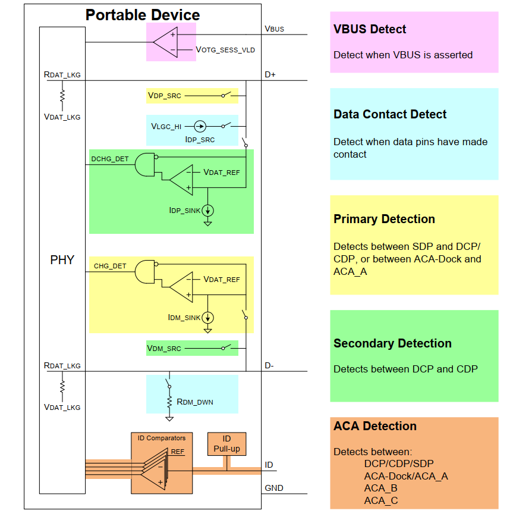

# BC1.2充电协议简介

随着智能手机、平板电脑及其他便携设备的普及，充电协议的标准化变得愈加重要。BC1.2（Battery Charging Specification 1.2）是一种广泛使用的充电协议，为设备间的充电兼容性提供了保障。本文将介绍BC1.2充电协议的基本概念以及其充电检测流程。

## 基本概念

USB2.0 协议规定外设从 USB 充电器抽取电流的最大值为500mA，500mA的电流限制无法满足日益增长的快充需求。因此，BC1.2 引入了充电端口识别机制，主要包括以下几个 USB 端口类型：

1. **标准下行端口（SDP）**

SDP 端口支持 USB 协议，最大电流 500mA，可以认为 SDP 就是普通的 USB 接口。

1. **充电下行端口（CDP）**

CDP 端口支持 USB 协议，最大电流 1.5A，可以认为 CDP 是支持快充的 USB 接口。

1. **专用充电端口（DCP）**

DCP 不支持数据协议，只支持快充，最大电流 1.5A，DCP 主要用于墙充等专用充电器。

注意：BC1.2 协议还定义了 ACA-Dock 和 ACA，由于 RK 平台没有支持这类设备，本人也未有相关调试经验，这里没有作说明。

## 充电检测流程

根据 USB BC1.2 规范，USB 设备主要通过以下步骤来实现充电检测：

VBUS 检测

数据连接检测（CDC）

首次检测（Primary Detection）

二次检测（Secondary Detection）

ACA 检测

USB 设备的识别电路结构如下图：

### VBUS 检测

当 USB 设备通过 USB 线接到 USB 主机端或者充电端口时，USB 主机端或者充电端口会在 VBUS 上提供一个 5V 的电压，这时在 USB 设备的 VBUS 上有一个电压比较器监测 VBUS 的电平值来判断是否插入成功。当 VBUS 上的电压大于电压比较器 VOTG_SESS_VLD 这一阀值电压(0.8V-4V)时，便向 USB 设备报告 VBUS 连接成功，准备进入数据连接检测阶段。

### 数据连接检测

当设备检测到 VBUS 插入成功，便会进入 DCD 模式，如上图，设备会在 D+ 线上加载电流源 IDP_SRC（7uA-13uA），在 D- 线上连接下拉电阻 RDM_DWN。

当设备连接到 SDP 和 CDP 等充电端口上时，D+ 线上的电压会被拉低到逻辑低电平 VLGC_LOW（0-0.8V），保持 TDCD_DBNC 之后，设备会认为数据连接成功，之后断开 IDP_SRC 和 RDM_DWN，并进入首次检测阶段。

当设备连接到 DCP 或者 ACA 等其他充电端口时，D+ 线电压会一直维持在 VLGC_HI，虽然可能存在数据连接成功情况，但依然检测不到数据线的连接，这时需要等待 TDCD_TIMEOUT 超时才能进入到首次检测阶段。

### 首次检测

首次检测主要用于区别 SDP 和 CDP/DCP。在首次检测过程中，设备会在 D+ 线上加载电压源 VDP_SRC（0.5V-0.7V），同时在 D- 线上加载电流源 IDM_SINK（2.5uA-175uA），然后通过 D- 线上的电压比较器来监测 D- 线上的电压是否高于 VDAT_REF（0.25V-0.4V）。

当设备连接到 SDP 时，如上图，RDM_DWN 会将 D- 线上的电压拉低到地，使 D- 线上的电压比较器检测到的电压低于 VDAT_REF，此时设备会判断出连接到 SDP 上。

当设备连接到 DCP 时，如上图，DCP 会通过电阻 RDCP_DAT（200欧）将 D+ 线和 D- 线短接起来，此时 D- 线上的电压值会被拉高到 VDP_SRC，使 D- 线上的电压比较器检测到的电压高于 VDAT_REF，从而与连接到 SDP 的情况分别开来。

当设备连接到 CDP 时，如上图，CDP 会在 D- 线上加载一个电压源 VDM_SRC，使 D- 线上电压比较器检测到的电压与 DCP 一样高于VDAT_REF。

结合以上三种充电端口的连接电路分析，在首次检测过程中，当监测到 D- 线上的电压低于 VDAT_REF 时，设备便会判断是连接到了 SDP，高于 VDAT_REF 时，则会判断是连接到了 DCP 或 CDP。接下来进入到二次检测阶段。

### 二次检测

二次检测主要是区分 DCP 和 CDP。进入二次检测，与首次检测的电路设置相反，设备会在 D- 线上加载电压源 VDM_SRC（0.5V-0.7V），同时在 D+ 线上加载电流源 IDP_SINK（25uA-175uA），然后通过 D+ 线上的电压比较器来监测 D+ 线上的电压是否高于 VDAT_REF。

当设备连接到 DCP 时，如上图，由于 DCP 会通过电阻 RDCP_DAT 将 D+ 线和 D- 线短接起来，所以在电压源 VDM_SRC 的作用下，D+ 线和 D- 线上的电压会被同时拉高，从而使用 D+ 线上的电压比较器检测到的电压高于 VDAT_REF，此时判断出连接到了 DCP 上。

当设备连接到 CDP 时，如上图，由于 CDP 没有将 D+ 线和 D- 线短接，所以 D+ 线上的电压会被 RDP_DWN 下拉至地，使 D+ 线上的电压比较器监测到的电压低于 VDAT_REF，此时判断出连接到了 CDP 上。

## 小结

BC1.2 充电协议是一种常见的USB充电协议，广泛应用于移动设备的快速充电。通过该协议，设备可以通过对 D+ 和 D- 信号的检测来识别充电器类型（如DCP、CDP、SDP等）并相应调整充电功率，实现高效充电。理解 BC1.2 的充电检测流程有助于开发人员更好地设计和优化充电管理策略。

以上是个人的理解总结，如有不对的地方欢迎指出！

**欢迎关注公众号“我的RK随记”，获取更多技术分享！**