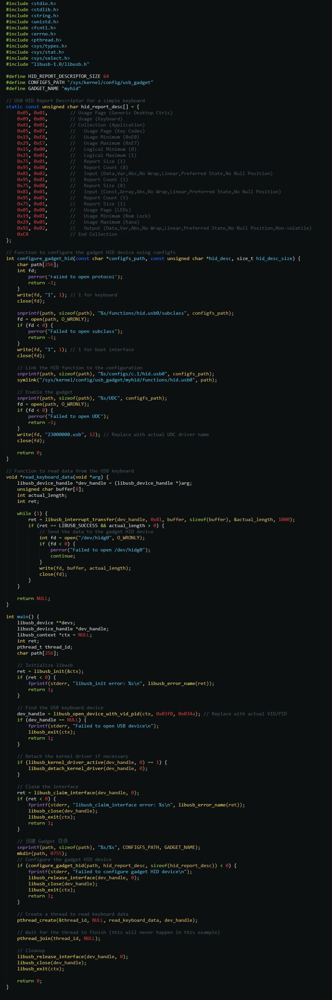
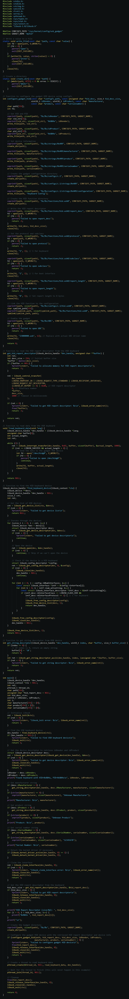

## 前言

在上一篇文章中，我利用 DeepSeek 在 RK3576 开发板上实现了一个基础的 HID 设备。虽然功能简单，但整个过程无需我手动编写代码，只需提出需求、修改配置，并在开发板上调试测试即可。接下来，我将继续借助 DeepSeek 逐步实现我的目标。

## 目标

实现从嵌入式系统的 USB HOST 口连接键盘，嵌入式系统的 USB OTG 口连接 PC，使键盘能够通过嵌入式系统直接操作 PC。同时，PC 上识别到的设备信息应与嵌入式系统 USB HOST 口连接的实体键盘保持一致。

## 实现过程

### 描述需求，生成代码

我向 DeepSeek 描述了以下需求：

> 我需要一个程序，能够将嵌入式系统上 USB HOST 口键盘的输入数据通过 USB HID 转发到该嵌入式系统 OTG 口上的虚拟 HID 设备。虚拟 HID 设备连接 PC，PC 能够接收到键盘输入。

DeepSeek 返回了以下代码（截图的代码已经调试过）：

### 代码解析

从生成的代码看，DeepSeek 在关键部分都做了标注，主要分为以下几个部分：

1. **HID 报告描述符**
   - 定义了 USB HID 设备的行为，告诉主机它是一个键盘。
2. **使用 configfs 配置 USB Gadget**
   - 通过 configfs 在 `/sys/kernel/config/usb_gadget` 目录下配置一个 HID 设备。
3. **读取 USB 键盘输入并转发**
   - 使用 `libusb_interrupt_transfer()` 监听 USB 键盘的输入。
   - 将接收到的按键数据写入 `/dev/hidg0`，发送给 USB Gadget。
4. **主程序：初始化 USB 设备并创建 Gadget**
   - 初始化 `libusb`，连接 USB 键盘。
   - 释放内核驱动，申请 USB 接口。
   - 调用 `configure_gadget_hid()` 创建 HID Gadget。
   - 创建线程监听键盘数据，转发到 HID Gadget。

从以上分析可以看出，生成的代码已经基本实现了我的需求。当我在开发板上运行代码时，确实实现了通过开发板 USB HOST 口的键盘直接操作 PC。然而，目前的实现仍有一些不足之处。例如，代码中的 HID 报告描述符是固定的，开发板传递给 PC 的键盘属性也是写死的。这会导致功能上的局限，如果连接的键盘 HID 报告描述符与固定的描述符差异较大，可能会影响功能。此外，PC 无法获取实际键盘的属性信息，如 VID、PID 和厂商信息等。

为了提升体验，我继续让 DeepSeek 对代码进行优化。

### 功能优化

基于以上代码，我再次让 DeepSeek 进行优化，主要包括以下几个方面：

1. **模块化与代码复用**
   - 将重复的文件写入操作封装为 `write_file` 函数，简化代码并提高可读性。
   - 将重复的目录创建操作封装为 `create_dir` 函数，减少重复代码。
2. **动态获取设备信息**
   - 自动查找开发板 USB HOST 口上的 HID 键盘设备。之前是通过固定的 `VID` 和 `PID` 打开设备的，为了更灵活地查找并匹配 HID 键盘设备，我让 DeepSeek 查找键盘的特征属性，以便找到符合 HID 键盘类且协议为键盘的设备。DeepSeek 实现了 `find_keyboard_device` 函数，该函数通过遍历 USB 设备列表，找到符合 HID 键盘类且协议为键盘的设备。
   - 动态获取开发板上 HID 键盘的 HID 报告描述符，而不是使用硬编码的 `hid_report_desc`。DeepSeek 实现了 `get_hid_report_descriptor` 函数，通过 `libusb_control_transfer` 获取设备的 HID 报告描述符。
   - 动态获取开发板上 HID 键盘的设备描述符和其他描述符，而不是使用固件的设备描述符。DeepSeek 使用 `libusb_get_device_descriptor` 获取开发板上 HID 键盘的 HID 设备描述符，并使用 `get_string_descriptor` 获取厂商信息、产品信息和设备序列号等字符串描述符。
3. **动态配置 Gadget**
   - 在 `configure_gadget_hid` 函数中，新增了对 `idVendor` 和 `idProduct` 的支持，根据实际设备的 `VID` 和 `PID` 动态配置 Gadget。
   - 新增了设备信息的配置（如 `serialnumber`、`manufacturer`、`product` 等），使 Gadget 的配置更加完整。

以下是优化完成后的代码：

### 优化后的改进

通过优化，代码实现了以下改进：

1. **灵活性提升**
   - 不再依赖固定的 `VID` 和 `PID`，能够自动查找并匹配 HID 键盘设备，适配性更强。
2. **设备信息动态获取**
   - 动态获取 HID 键盘的 HID 报告描述符和设备描述符，确保 PC 能够正确识别键盘属性。
3. **代码结构优化**
   - 通过模块化设计，减少了重复代码，提高了代码的可读性和可维护性。

### 总结

通过 DeepSeek 的帮助，我成功实现了 USB HID 桥接功能，并对其进行了优化，使其更加灵活和健壮。接下来，我将继续探索更多功能，进一步完善我的代码。