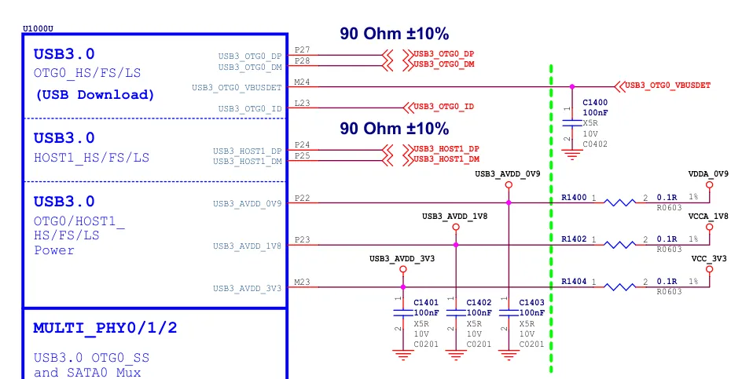
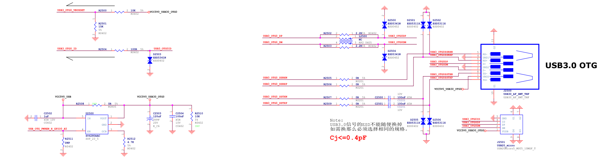
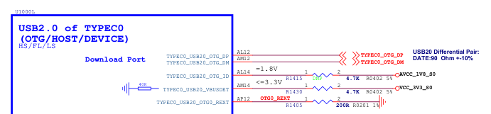
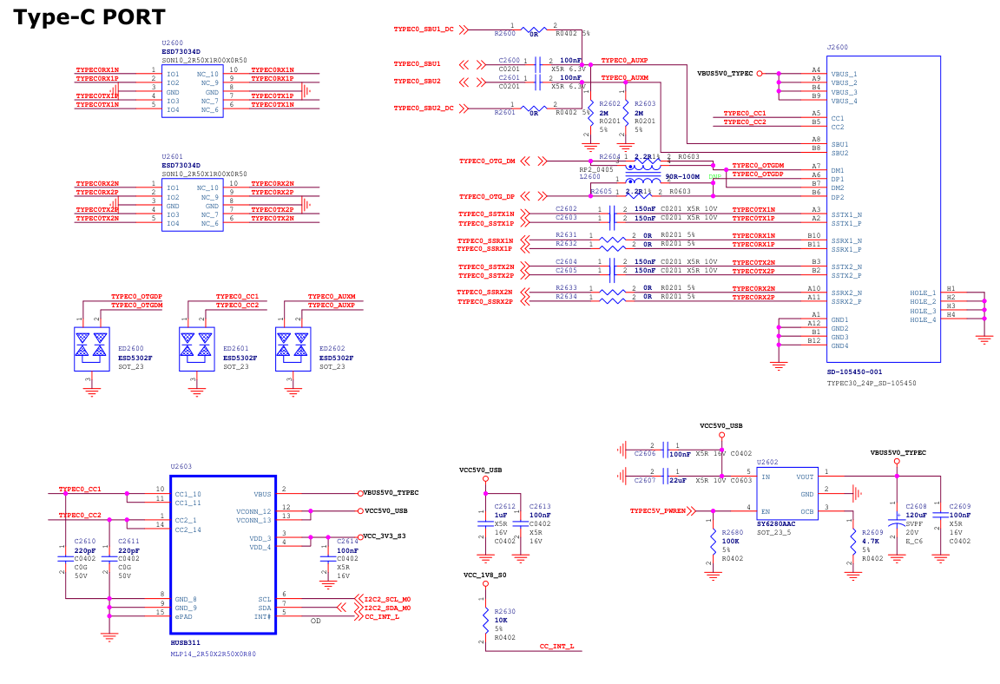

## VBUS
在 USB 2.0 协议中，VBUS 是负责供电的物理线路（+5V 电源线），主机和设备对 VBUS 的定义和管理涉及供电、检测和电源管理等方面有所差异。以下是详细的定义和角色划分：
### 主机（HOST）对 VBUS 的定义
- 供电角色：
    - 主机作为电源提供者（Power Source），通过 VBUS 线为连接的设备供电。
    - 电压规范：主机提供的 VBUS 电压范围为 4.75V–5.25V。
    - 电流限制：标准下游端口支持最大电流 500mA，充电端口或专用充电器可能支持更高电流。
- 连接检测机制：主机的 VBUS 是一直供电的，一般不通过 VBUS 来检测连接状态。
### 设备（DEVICE）对 VBUS 的定义
- 受电角色：
    - 设备作为电源消费者（Power Sink），通过VBUS获取电力。
    - 电压容差：设备需在 4.40V–5.25V 范围内正常工作。
    - 电流限制：设备在枚举时需向主机报告其最大电流需求，不得超过主机支持的电流上限。
- 连接检测机制：
    - 连接：设备需监测 VBUS 电压，当检测到有效电压时，启动内部电路并准备与主机通信。
    - 断开：设备需检测 VBUS 电压，当检测到断开（如主机断电或线缆拔出），触发断开逻辑。

### 小结
当 USB 口做 HOST 模式时，VBUS 只要默认输出供电即可，当 USB 口做 DEVICE 模式时，需要监测 VBUS 的电压，来检测设备的连接状态。因此，本文主要讨论 RK 平台芯片 OTG 口做设备的时候 VBUS 的设计。
## RK 平台常见的 VBUS 设计
### Type-A
以 RK3568-EVB1 开发板为例，OTG 口的设计电路如下：

说明：
- 主控端 OTG 口的 VBUS 检测引脚是`USB3_OTG0_VBUSDET`，由于 USB 座子端的 VBUS 是 5V，`USB3_OTG0_VBUSDET`的输入电压小于 5V，因此需要添加分压电路将 VBUS 和`USB3_OTG0_VBUSDET`连接。
- OTG 口做 HOST 模式的时候，VBUS 需要输出 5V，这里拉高`USB_OTG_PWREN_H_GPIO0_A5`引脚输出 5V。
- OTG 口做 DEVICE 模式的时候，VBUS 不需要输出 5V，这里拉低`USB_OTG_PWREN_H_GPIO0_A5`引脚关闭 5V。
- OTG 口做 DEVICE 模式连接 HOST 口的时候，VBUS 有 5V 输入，`USB3_OTG0_VBUSDET`会被拉高，USB-PHY 检测到 VBUS 连接中断，触发 [BC1.2 充电检测](https://mp.weixin.qq.com/s/QnGiW8Qp5Nx7t2zFr22Kgg)，从而使能 USB 口，触发 USB 枚举。
- OTG 口做 DEVICE 模式与 HOST 口断开连接的时候，`USB3_OTG0_VBUSDET`为低电平，USB-PHY 检测到 VBUS 断开中断，关闭 USB 功能。
### Type-C
以 RK3588-EVB1 开发板为例，OTG 口的设计电路如下：

说明：

- 主控端 OTG 口的 VBUS 检测引脚是`TYPEC0_USB20_VBUSDET`，直接上拉到`VCC_3V3_S0`，该设计考虑到Type-C 口需要支持 PD 快充，充电电压可能高于 5V，因此这里不与 Type-C 口的 VBUS 直连，OTG口 做 DEVICE 模式时的断开检测由 Type-C 芯片（这里是 HUSB311）实现。
- OTG 口做 HOST 模式的时候，VBUS 需要输出 5V，这里拉高`TYPEC5V_PWREN`引脚输出 5V。
- OTG 口做 DEVICE 模式的时候，VBUS 不需要输出 5V，这里拉低`TYPEC5V_PWREN`引脚关闭 5V。
### VBUS 常供电的 Type-A
以某个 RK3568 板子为例，OTG 口的设计电路如下：

说明：
- 主控端 OTG 口的 VBUS 检测引脚是`USB2_OTG0_VBUSDET`，由于`USB2_OTG0_VBUSDET`的输入电压小于3V，这里添加分压电路将`VCC_3V3_S0`和`USB2_OTG0_VBUSDET`连接，使`USB2_OTG0_VBUSDET`保持常拉高。
- OTG 口做 HOST 模式的时候，VBUS 需要输出 5V，这里拉高`USB_OTG_PWREN_H`引脚输出 5V。
- OTG 口做 DEVICE 模式的时候，VBUS 不需要输出 5V，这里拉低`USB_OTG_PWREN_H_GPIO0_A5`引脚关闭 5V。
- OTG 口做 DEVICE 模式的时候，由于`USB2_OTG0_VBUSDET`保持常拉高，因此主控无法通过 VBUSDET 来检测是否有连接 HOST 设备，因此，在使用过程中会出现断开 USB 连接的时候无法检测到拔出的情况。这种情况下，代码需要加补丁，让 USB 控制器来识别断开和连接状态。
### DWC3 控制器识别连接状态
在《VBUS 常供电的 Type-A》设计中，OTG 做 DEVICE 模式的时候 USB-PHY 没办法通过 VBUSDET 来检测是否有连接 HOST 设备，因此这里通过 USB 控制器来实现，在 RK3568 平台，OTG 口的 USB 控制器是 DWC3，这里通过代码说明 DWC3 控制器如何识别断开状态。
补丁：

原理：
USB 断开连接的时候，DWC3 会触发一个`DWC3_DEVICE_EVENT_EOPF`中断，收到中断后主动触发 DWC3 的断开中断函数`dwc3_gadget_disconnect_interrupt`，实现断开操作。
### 总结
以上介绍了 RK 平台 USB OTG 口的 VBUS 设计问题，如果是 Type-C 口，OTG 口做 DEVICE 模式时可以通过 Type-C 芯片来监测连接状态；如果是 Type-A 口，OTG 口做 DEVICE 模式时需要通过 VBUSDET 来监测连接状态，如果硬件已经做成了 VBUSDET 常拉高的设计，可以通过 USB 控制器来监测连接状态，但是建议还是保留 VBUSDET 来监测连接状态，稳定性更好。