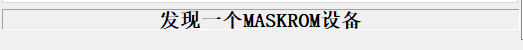
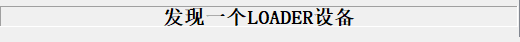
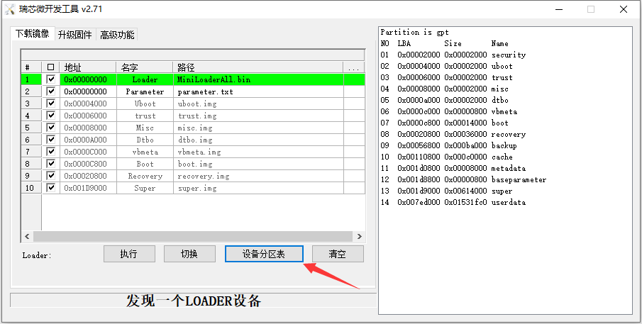

在RK平台开发过程中，我们在使用烧录工具烧写固件的时候经常可以看到烧录工具会显示当前PC识别到的设备类型，一般有：MASKROM，LOADER，ADB，MSC等等。能烧录固件的模式有MASKROM模式和LOADER模式，本文主要说明这两种模式的使用。



注意：要windows PC识别到板子，windows需要安装RK的驱动软件，驱动软件在SDK里面可以获得。
## MASKROM模式
当flash处于空白阶段，把板子接到PC上时，CPU自带的程序会把otg口初始化成device模式与PC通信，这时候PC上可以识别到MASKROM模式，这时候可以直接烧录固件。

进入maskrom模式的方法：
* 新生产出来的板子
* 短接flash上电(一般是把clk脚与地短接)
* 在uboot命令行阶段，执行：`rbrom`
## LOADER模式
板子已经烧录了loader固件的情况下，开机之后可以进入loader模式进行烧录固件。
进入loader模式的方法：
* 板子的otg口连接PC，按住recovery键上电
* 板子开机状态下，在调试串口或者adb命令行模式下执行：`reboot loader`
* 调试串口进入uboot命令行模式，执行：
```bash
rockusb 0 mmc 0 #板子用的是emmc时
rockusb 0 rknand 0 #板子用的是nan flash时
rockusb 0 spinand 0 #板子用的是spi nand flash时
```
## LOADER模式的其他用法
loader模式下，可以通过烧录工具的“设备分区表”选项把板子里面的分区表读出来，这样在单独烧录某个分区的时候就不会出现烧错分区地址的情况。


