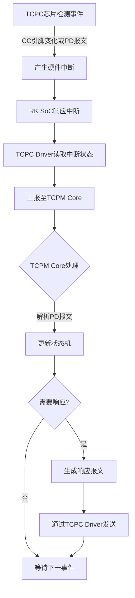

## 前言

在现代移动设备、嵌入式系统和物联网硬件中，Type-C接口因其强大的充电能力和灵活的数据传输能力已成为主流。对于采用 RK 平台的开发者而言，要驾驭Type-C接口的全部潜力，尤其是复杂的PD协议，就必须深入了解其背后的软件核心——**TCPM**。

## 一、什么是TCPM？

TCPM，全称 **Type-C Port Manager**，即Type-C端口管理器。它是一个软件框架和协议栈，负责管理和控制Type-C端口控制器（TCPC）硬件，并实现USB Type-C规范和USB Power Delivery（PD）协议中定义的复杂状态机、策略和通信过程。

可以将其理解为Type-C接口的“大脑”，具体可以分成以下几个层次：

*   **硬件抽象层**：它向下屏蔽了不同TCPC芯片（如FUSB302、HUSB311等）的寄存器差异，提供统一的操作接口。
*   **协议实现层**：它完整实现了Type-C连接检测、角色切换、功率协商、数据传输模式切换等核心逻辑。
*   **策略管理层**：它向上层提供API，允许系统根据自身能力（如电源供电能力、支持的数据模式）来制定策略，决定接受或拒绝何种电源合约或模式请求。

在Linux系统中，TCPM是作为内核子系统存在的，其主要代码位于 `drivers/usb/typec/` 目录下，与整个Linux USB子系统紧密集成。

## 二、为什么RK平台需要TCPM？

RK平台的SoC本身通常并不直接内置完整的Type-C PD控制器硬件，而是需要通过I2C总线连接一个外部的TCPC芯片（例如RK推荐的FUSB302，HUSB311等）。TCPC芯片负责处理底层的模拟信号检测、CC通信和PD报文收发。

然而，仅有硬件是不够的。PD协商是一个高度动态和策略性的过程，涉及大量的状态判断和超时管理。如果让开发者直接通过I2C去操作TCPC芯片的寄存器来实现所有功能，将极其复杂且容易出错。

TCPM的价值就在这里体现：

1.  **简化开发**：TCPM框架提供了成熟的、经过验证的协议栈。RK平台的驱动开发者只需实现特定TCPC芯片的底层I2C读写函数（即TCPC驱动），并将其注册到TCPM框架中即可。剩下的复杂协议逻辑全部由TCPM统一处理。
2.  **保持一致性与可靠性**：由于所有厂商的TCPC驱动都遵循同样的框架接口，保证了不同硬件平台上的Type-C行为是一致的、符合规范的，大大提升了系统的稳定性和兼容性。
3.  **功能强大且灵活**：TCPM支持双角色角色（DRP）、尝试角色（Try.SRC/.SNK）、电源角色交换（Power Role Swap）、数据角色交换（Data Role Swap）、VCONN交换以及各种Alternate Mode（如DisplayPort）的协商，满足了RK平台从平板、笔记本到智能家居等各种应用场景的需求。

## 三、TCPM在RK平台软件栈中的位置

TCPM在RK平台系统中的层次结构：

1.  **硬件层（Hardware）**：
    *   RK SoC（如RK3588）
    *   外部TCPC芯片（如FUSB302）
    *   Type-C物理连接器

2.  **内核驱动层（Kernel Space）**：
    *   **TCPC Driver**：由RK或芯片供应商提供，负责直接读写TCPC芯片的寄存器。
    *   **TCPM Core**：调用TCPC提供的操作接口，执行PD状态机，管理定时器，处理PDO选择策略等。
    *   **PD Policy Engine**：通常内置于TCPM Core中，负责根据系统电源能力（由Charger IC驱动提供）来协商最佳的电源合约。

3.  **用户空间（User Space）**：
    *   通过 `sysfs` 用户空间接口可以监控Type-C端口的状态（如 `cat /sys/class/typec/port0/port_type`），或在某些情况下切换状态（如 `echo host > /sys/class/typec/port0/data_role`）。

USB Type-C/TCPC 通信流程：

## 总结

对于 RK 平台开发者而言，理解 TCPM 是进行 Type-C 接口开发的重要基础。它不仅仅是一个驱动，更是一个承上启下的软件框架。掌握 TCPM 的角色、工作原理及其在系统架构中的位置，将有助于更高效地调试 Type-C 相关的问题。后续我们将深入分析 TCPM 的工作流程，包括状态机跳转和 RK 平台调试技巧，助力开发者充分释放 Type-C 的潜力。