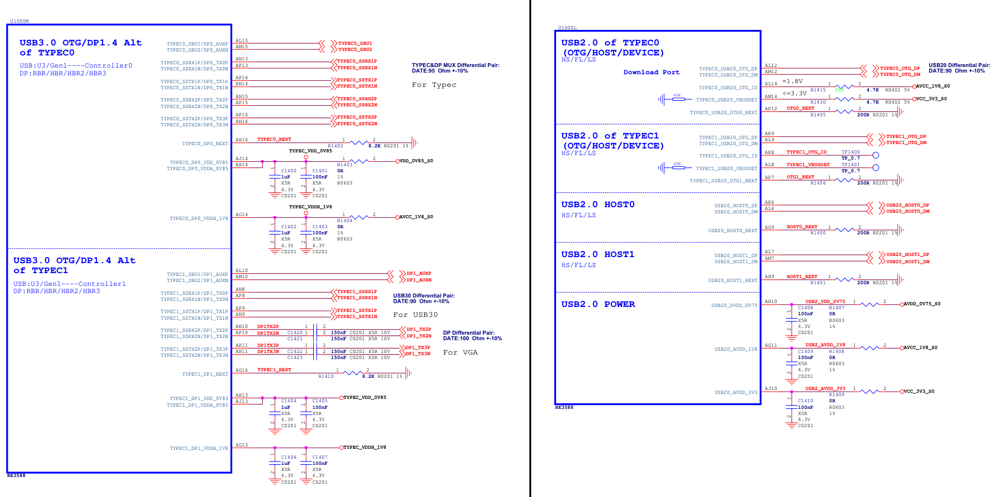
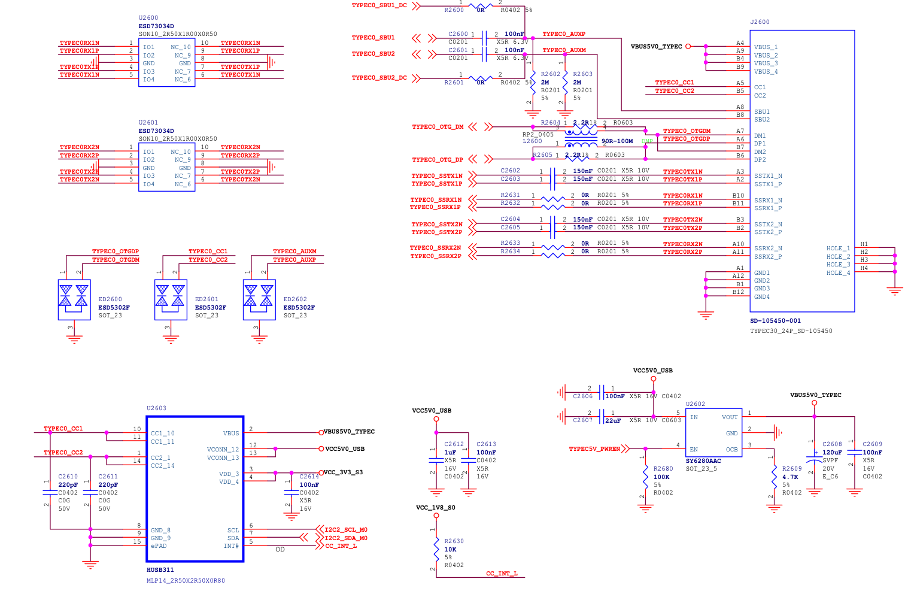
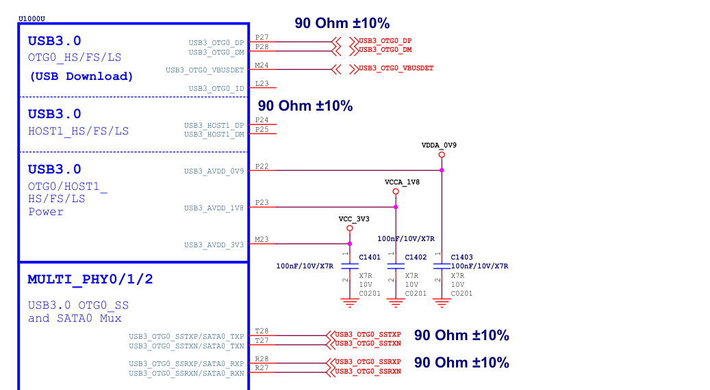
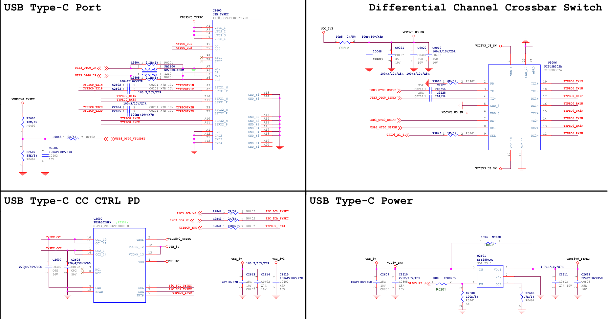
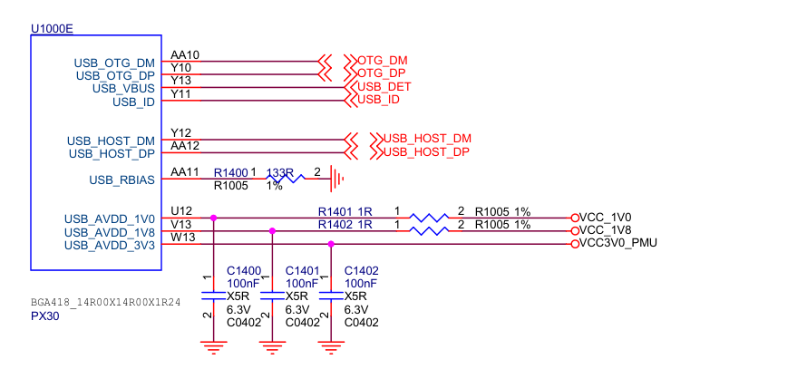
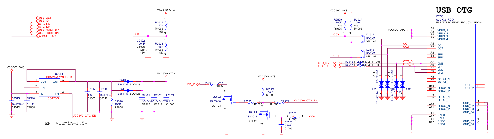

## 前言
Type-C 接口凭借其多功能性和便利性，已成为当下电子产品的主流接口之一。在 RK 平台中，对 Type-C 接口的支持也在不断发展 —— RK3399 是首个支持全功能 Type-C 的芯片，此后 RK3588、RK3576 等芯片陆续跟进。对于本身不支持全功能 Type-C 的主控，也可通过硬件设计实现基础 Type-C 功能。本文将从功能特性、硬件设计、软件框架等方面，聊聊 RK 平台的 Type-C 接口相关知识。
## Type-C 接口的基础特性
Type-C 接口根据功能完整性，可分为 “全功能” 和 “非全功能” 两类，核心差异在于是否支持高速数据传输、视频输出、大功率充电等扩展功能。
### 全功能 Type-C 接口
全功能 Type-C 接口不仅具备传统 USB 的数据传输能力，还整合了高速数据传输、高功率充电、视频输出等多种功能。以下是全功能 Type-C 接口的主要特性：
- **正反插自由**：无需区分方向，解决传统 USB “插不准” 问题；
- **高速数据传输**：支持 USB 3.0 向下兼容 USB 2.0；
- **角色自动切换**：可自动识别 “主机”（如电脑）或 “从设备”（如手机）角色；
- **视频直接输出**：支持 DisplayPort Alternate Mode（DP Alt Mode），可输出视频信号；
- **大功率充电**：支持 USB Power Delivery（PD）协议，最高提供 100W（20V/5A）功率输入 / 输出。
RK 平台支持全功能 Type-C 的主控：RK3399、RK3588/RK3588S、RK3576。
### 非全功能 Type-C 接口
非全功能 Type-C 是 “功能有取舍” 的类型，保留基础功能但缺失部分扩展功能。例如：
- 可能不支持 DP 视频输出；
- 可能仅支持 USB 2.0；
- 可能不支持 PD 快充。
但无论如何，基础的 USB 数据传输、充电、正反插设计均可保留，满足日常使用需求。
## RK 平台 Type-C 接口的硬件设计

### 全功能 Type-C 接口硬件设计（以 RK3588 为例）


RK3588 的 Type-C 接口需同时支持 USB3.0、DP 视频输出、PD 快充等功能。
1. **USB2.0 信号：通过分路实现正反插兼容**
    - RK3588 的 TYPEC0 提供 1 组 USB2.0 差分对（DP/DM），同时连接 Type-C 座子的 A 面和 B 面；
    - 无论正插（A 面接触）还是反插（B 面接触），至少有一组信号可正常通信，确保基础数据传输和充电功能不中断。
2. **USB3.0 与 DP 视频：双模信号复用设计**
    - RK3588 的 TYPEC0 提供 2 组 USB3.0 差分对（RX/TX），同时支持 DP Alt Mode；
    - 两组信号分别连接座子 A 面和 B 面，保证正反插时均可匹配 USB3.0 或 DP 功能。
3. **协议与功率控制：依赖 HUSB311 芯片**
    - Type-C 座子的 CC1/CC2 引脚（用于功能协商）连接 HUSB311 芯片；
    - 该芯片通过 I2C 与 RK3588 通信，负责：插拔检测、正反插识别、角色切换、PD 协议协商（最高 100W）、DP 模式切换。
### 非全功能 Type-C 接口硬件设计（典型案例）
非全功能 Type-C 的设计核心是 “保留基础功能，舍弃扩展功能”，以下为两类典型方案：
#### 案例 1：RK3568（支持 USB3.0 和 PD，但不支持 DP）


- **USB2.0 设计**：与 RK3588 一致，通过分路连接 A 面和 B 面，保证正反插基础通信；
- **USB3.0 设计**：仅提供 1 组 USB3.0 差分对，需通过 Switch 芯片切换 A 面 / B 面连接（正插时连 A 面，反插时连 B 面）；
- **协议控制**：依赖 FUSB302 芯片（通过 I2C 通信），实现插拔检测、角色切换、PD 协商及 USB3.0 切换；
- **功能限制**：因 USB3.0 接口不支持 DP 输出，故无法通过 Type-C 输出视频。
#### 案例 2：PX30（仅支持 USB2.0，不支持 USB3.0、DP 和 PD）


- **USB2.0 设计**：通过分路连接 A 面和 B 面，保证正反插基础通信；
- **角色识别**：无需额外协议芯片，直接通过 CC1/CC2 引脚连接主控 USB_ID 引脚 —— 插主机时 USB_ID 为高电平（从设备模式），插从设备时为低电平（主机模式）；
- **功能限制**：无 USB3.0 差分对（不支持高速传输），无协议芯片（不支持 PD 快充），无 DP 相关设计（不支持视频输出）。
## Type-C 接口的软件框架
RK 平台有两套驱动框架实现 Type-C 功能，适配不同芯片和内核版本：
1. 早期专用框架：mfd/fusb302.c
    - 仅支持 FUSB302 协议芯片；
    - 适用于早期芯片（如 RK3399 初期版本），功能单一。
2. 通用开源框架：tcpm（Kernel4.19 及以上）
    - 支持多类协议芯片（FUSB302、HUSB311、ET7303 等）；
    - 兼容性更强，可通过配置适配不同主控（如 RK3588、RK3576），是目前主流方案。
## Type-C 接口调试基础流程
Type-C 接口的调试需结合硬件配置验证与软件日志分析，逐步定位功能异常点。以下是针对 RK 平台的具体调试步骤：
### 配置DTS
RK 平台的芯片均提供配套 SDK 文档，以 RK3588 为例，在其文档`Rockchip_RK3588_Developer_Guide_USB_CN.pdf`中有`Type-C USB 3.1/DP 全功能 DTS 配置`章节，里面详细介绍了 Type-C 芯片相关的 DTS 配置，这里作部分摘录：
```c
#USB2.0 PHY配置属性"rockchip,typec-vbus-det"，表示支持Type-C VBUS_DET常拉高的硬件设计
&u2phy0_otg {
        rockchip,typec-vbus-det;
};

#USB3.1/DP PHY0，需要根据硬件设计，配置属性"sbu1-dc-gpios"和"sbu2-dc-gpios"
&usbdp_phy0 {
        orientation-switch;
        svid = <0xff01>;
        sbu1-dc-gpios = <&gpio4 RK_PA6 GPIO_ACTIVE_HIGH>;
        sbu2-dc-gpios = <&gpio4 RK_PA7 GPIO_ACTIVE_HIGH>;

        port {
                #address-cells = <1>;
                #size-cells = <0>;
                usbdp_phy0_orientation_switch: endpoint@0 {
                        reg = <0>;
                        remote-endpoint = <&usbc0_orien_sw>;
                };

                usbdp_phy0_dp_altmode_mux: endpoint@1 {
                        reg = <1>;
                        remote-endpoint = <&dp_altmode_mux>;
                };
        };
};

#USB3.1 OTG0 Controller
&usbdrd_dwc3_0 {
        dr_mode = "otg";
        usb-role-switch;
        port {
                #address-cells = <1>;
                #size-cells = <0>;
                dwc3_0_role_switch: endpoint@0 {
                        reg = <0>;
                        remote-endpoint = <&usbc0_role_sw>;
                };
        };
};

#VBUS GPIO配置，在Type-C控制器芯片驱动中控制该GPIO
vbus5v0_typec: vbus5v0-typec {
        compatible = "regulator-fixed";
        regulator-name = "vbus5v0_typec";
        regulator-min-microvolt = <5000000>;
        regulator-max-microvolt = <5000000>;
        enable-active-high;
        gpio = <&gpio4 RK_PD0 GPIO_ACTIVE_HIGH>;
        vin-supply = <&vcc5v0_usb>;
        pinctrl-names = "default";
        pinctrl-0 = <&typec5v_pwren>;
};

#配置外置Type-C控制器芯片FUSB302
#需要根据实际的硬件设计，配置"I2C/interrupts/vbus-supply/usb_con"的属性
&i2c2 {
        status = "okay";
        usbc0: fusb302@22 {
                compatible = "fcs,fusb302";
                reg = <0x22>;
                interrupt-parent = <&gpio3>;
                interrupts = <RK_PB4 IRQ_TYPE_LEVEL_LOW>;
                pinctrl-names = "default";
                pinctrl-0 = <&usbc0_int>;
                vbus-supply = <&vbus5v0_typec>;
                status = "okay";

                ports {
                        #address-cells = <1>;
                        #size-cells = <0>;

                        port@0 {
                                reg = <0>;
                                usbc0_role_sw: endpoint@0 {
                                        remote-endpoint = <&dwc3_0_role_switch>;
                                };
                        };
                };

                usb_con: connector {
                        compatible = "usb-c-connector";
                        label = "USB-C";
                        data-role = "dual";
                        power-role = "dual";
                        try-power-role = "sink";
                        op-sink-microwatt = <1000000>;
                        sink-pdos =
                                <PDO_FIXED(5000, 1000, PDO_FIXED_USB_COMM)>;
                        source-pdos =
                                <PDO_FIXED(5000, 3000, PDO_FIXED_USB_COMM)>;

                        altmodes {
                                #address-cells = <1>;
                                #size-cells = <0>;

                                altmode@0 {
                                        reg = <0>;
                                        svid = <0xff01>;
                                        vdo = <0xffffffff>;
                                };
                        };

                        ports {
                        	......
                        };
                };
        };
```
### 开启调试日志
通过开启调试日志，可实时观察 Type-C 接口的插拔检测、角色切换、协议协商等过程，定位异常环节。具体方法因软件框架而异：
#### 基于 mfd/fusb302.c 驱动
该驱动仅支持 FUSB302 芯片，以下是两种方法（二选一）：
1. 参考《[开启dev_dbg方法](https://mp.weixin.qq.com/s/R5GLYlFBHRHrRWMAdo9fJw)》，开启动态调试；
2. 在驱动代码首行添加`#define DEBUG`宏，重新编译内核，通过`dmesg | grep fusb302`查看日志。
#### 基于 tcpm 框架
该框架支持多类协议芯片，可通过调试接口直接读取日志：
1. 确定 Type-C 协议芯片的 I2C 总线编号与地址（如硬件连接到 I2C2，地址 0x4e）；
2. 执行以下命令查看实时日志：
```shell
#格式：/sys/kernel/debug/usb/tcpm-[I2C总线]-[地址]/log
cat /sys/kernel/debug/usb/tcpm-2-004e/log
```
## 小结
RK 平台的 Type-C 接口分为全功能与非全功能两类：全功能型号（如 RK3588、RK3399）完整支持 USB3.0 高速传输、DP 视频输出及 PD 快充，满足复杂场景需求；非全功能型号（如 RK3568、PX30）则保留基础数据传输、充电及正反插设计，平衡成本与实用性。这种分层设计让用户能依据产品定位灵活选型，兼顾功能与性价比。