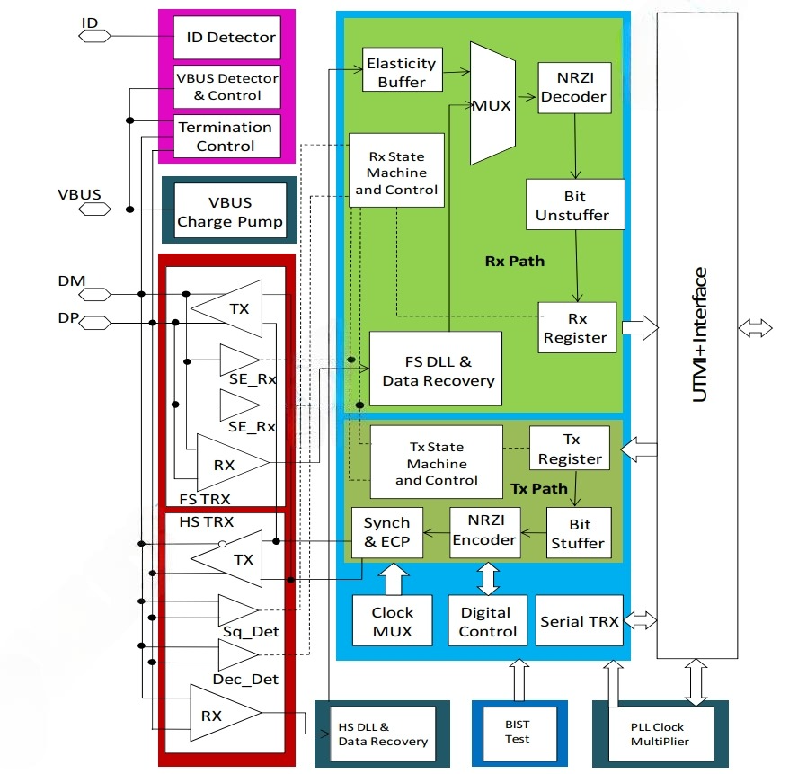
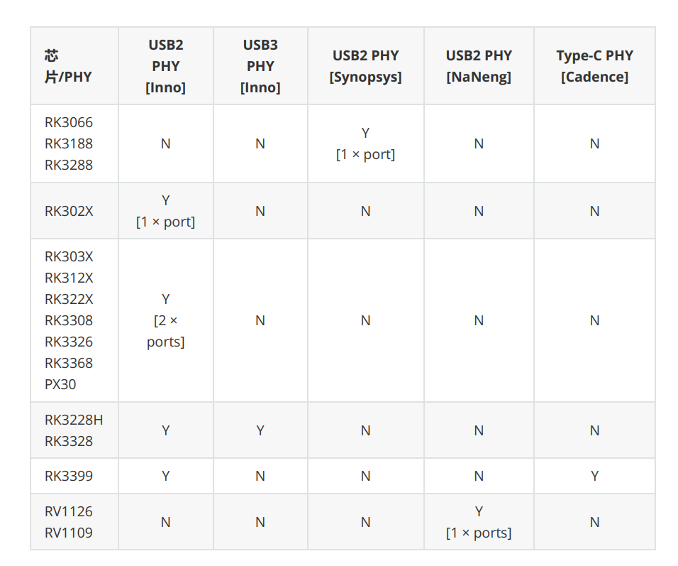

# 认识 USB PHY

在 USB 传输链路中，USB PHY 作为物理层协议的核心组件，扮演了至关重要的角色。本文将带领大家认识 USB PHY 模块，了解它的基本工作原理和应用场景。

## 什么是 USB PHY ？

USB PHY 是指 USB 物理层接口，它负责将 USB 协议的数据流从逻辑信号（通常是数字信号）转换为物理信号，以便通过 USB 线缆进行传输。反之，它也会接收来自 USB 线缆的物理信号，并将其转换为数字信号，供上层协议栈处理。

简而言之，USB PHY 是连接数字世界和物理世界的桥梁，负责信号的电气化处理。

## USB PHY 的功能

USB PHY 的核心功能是进行信号的物理层转换，包括：

1. **物理信号与逻辑信号的转换**：将 USB 控制器生成的数字逻辑信号转换为适合传输的物理电气信号，并通过 USB 线缆发送。同时，它也会将从 USB 线缆接收的物理信号解码为数字信号，交给上层的 USB 控制器进行处理。
2. **信号调制与解调**：在发送数据时，USB PHY 将逻辑数据调制成差分信号（D+ 和 D- 差分对），以便提高抗干扰能力和传输质量。在接收数据时，它则负责解调接收到的差分信号，将其还原为逻辑信号。
3. **信号放大与恢复**：为了保证数据完整性，USB PHY 在传输过程中会对信号进行放大，并在接收端对信号进行恢复。
4. **时钟恢复与同步**：USB PHY 模块负责时钟恢复，以确保数据传输的同步。
5. **USB 信号检测**：包括插拔检测、速度检测（如高速、全速、低速等）以及信号的校验等。

## USB PHY 内部模块

USB PHY 的具体组成可能因 USB 版本的不同而有所差异，这里以 INNO USB2.0 PHY 为例，介绍 USB PHY 的内部模块。

1. **HS TRX**：TX 和 RX 是差分信号用于的发送和接收，Sq_Det 是 Squelch detector，用于调整信号灵敏度的噪声值，Dec_Det 是 Disconnection envelope detector，用于调整断开检测阀值。
2. **FS TRX**：TX 和 RX 是差分信号用于的发送和接收，两个 SE_Rx 是 Single ended receivers，用于低速和全速信号的探测，包括断开和连接信号等。
3. **Tx Path**：Tx State Machine and Control 负责 PHY 和 USB 控制器之间将数据与同步信号（Sync）和传输结束信号（EOP）进行同步；Tx Register 模块负责根据命令从总线接口读取并行数据，并将其序列化后用于通过 USB 进行传输；Bit Stuffer 是为了确保信号有足够的跳变，在通过 USB 发送数据包时，如果出现连续六个“1”，必须在其后插入一个“0”，然后再对数据进行 NRZI 编码；NRZI Encoder 是编译器，NRZI 编码规则是：当发生状态跳变时，将数据“0”编码；当没有状态跳变时，将数据“1”编码。
4. **Rx Path**：Elasticity Buffer 是弹性缓冲器，为了补偿发送端和接收端时钟之间的差异，将提取的高速（HS）数据与 PLL 内部时钟进行同步。MUX 是多路复用模块，允许来自高速（HS）或全速/低速（FS/LS）接收器的数据被路由到共享的接收逻辑中。NRZI Decoder 是 RNZI 解码器，是编码器的逆过程，电平变化解码为“0”，而电平不变化解码为“1”。Bit Unstuffer 与 Tx Path 的 Bit stuffer 作用相反，能够识别数据流中的填充位，将其丢弃，还负责检测位填充错误，该错误会被解释为高速（HS）传输结束信号（EOP）。Rx Register 模块负责将接收到的数据进行反序列化，并将 8 位并行数据传输到应用总线接口。Receiver State Machine and Control 负责控制控制器与 PHY 在接收路径（RX path）中的通信，从数据中去除同步信号（SYNC）和传输结束信号（EOP）。
5. **PLL Clock Multiplier**：该模块可以选择由片外晶振或者片上时钟倍频器来做时钟模块。它生成适用于 UTM 和 CLK 输出信号的内部时钟，所有数据传输信号都与 CLK 信号同步。
6. **Clock MUX**：该模块为 TX Path 和 RX Path 提供合适的时钟，并确保时钟平稳切换。
7. **Digital Control**：该模块负责控制、启用和禁用系统中的各个不同模块。
8. **Serial TRX**：该模块接口允许复用现有的 FS/LS 主控制器 IP，实现串行数据包传输。
9. **ID Detector**：该模块提供一个 ID 引脚，做 otg 口时用来自动切换 device/host 模式。
10. **VBUS Detector&Control**：用于监测和感知 USB 总线电源线上的电压。

## 常见的 USB PHY

市场上有多种 USB-PHY，RK采用的 USB PHY 主要有如下四种： 

USB2.0 PHY [Vendor: Innosilicon]

USB3.0 PHY [Vendor: Innosilicon]

USB2.0 PHY [Vendor: Synopsys]

Type-C PHY [Vendor: Cadence]

下面为各芯片采用的 USB PHY，其中 [1 × port] 表示一个 PHY 支持一个 USB port，[2 × ports]

表示一个 PHY 支持两个 USB port。

## USB PHY 常用调试手段

1. **调整 USB 驱动能力**：由于硬件设计或者 USB 线缆较长导致 USB 信号损耗较大的情况下，通过调整 USB 驱动能力可以改善信号，修复 USB 眼图不达标问题。
2. **调整 USB 断开检测阀值**：USB 断开检测阀值是指检测 USB 设备与主机连接状态的电压门限值。通过调整该阀值，可以灵活设置何时判定设备断开，解决 USB 主机识别不到设备断开或者误识别到设备断开。
3. **调整 USB 噪声值**：调整噪声值可以帮助 PHY 更好地处理信号中的噪声干扰，尤其是在恶劣环境下，能够提高通信的稳定性。设置合适的噪声容忍范围，可以防止噪声引发的错误数据传输或设备断开。
4. **实现充电检测**：BC1.2 充电检测是在 USB PHY 实现的，USB 设备可以识别连接的充电器类型（例如SDP、CDP、DCP等），从而在不同的电流条件下进行安全充电。BC1.2 实现充电检测后，设备可以自动适应充电环境并调整充电速率。

以上具体的调试方法将在后面的文章中说明。

## 结语

USB PHY 模块作为 USB 通信链路中的关键组件，承担了物理层信号处理的重任。嵌入式开发过程中，理解 USB PHY 的工作原理是开发者在项目中取得成功的基础。希望通过本文的介绍，大家能够更好地认识 USB PHY 模块，并在今后的开发过程中加以灵活应用。

以上是个人的理解总结，如有不对的地方欢迎指出。