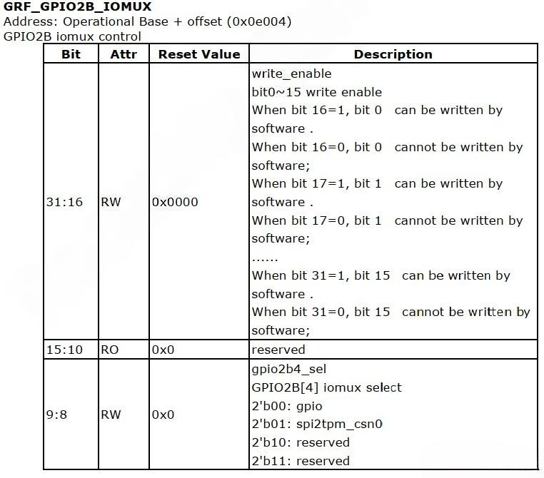
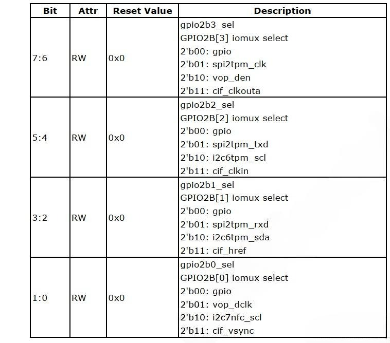
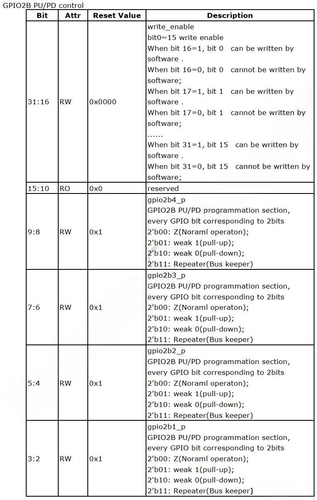
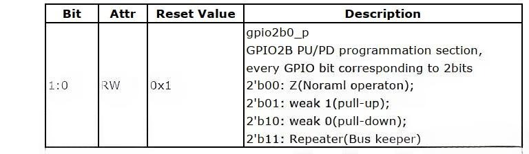

## 简介
RK平台开发过程经常要用到IO指令，主要是用来读写CPU各个模块寄存器的值，从而实现在线调试。
RK平台的SDK默认有包含IO指令的源码，如果执行的时候找不到指令，可能是没有编译进去，找到对应的编译脚本编译进去即可。
由于IO指令是直接操作CPU寄存器，因此与SDK版本无关，无论是Android还是Linux，使用的方法都是一样的，但是不同芯片的寄存器地址不一样，因此，每个芯片的操作指令是不同的。

## 基本操作
### 查看帮助文档
```bash
console:/ # io
Raw memory i/o utility - $Revision: 1.5 $

io -v -1|2|4 -r|w [-l <len>] [-f <file>] <addr> [<value>]

    -v         Verbose, asks for confirmation
    -1|2|4     Sets memory access size in bytes (default byte)
    -l <len>   Length in bytes of area to access (defaults to
               one access, or whole file length)
    -r|w       Read from or Write to memory (default read)
    -f <file>  File to write on memory read, or
               to read on memory write
    <addr>     The memory address to access
    <val>      The value to write (implies -w)

Examples:
    io 0x1000                  Reads one byte from 0x1000
    io 0x1000 0x12             Writes 0x12 to location 0x1000
    io -2 -l 8 0x1000          Reads 8 words from 0x1000
    io -r -f dmp -l 100 200    Reads 100 bytes from addr 200 to file
    io -w -f img 0x10000       Writes the whole of file to memory

Note access size (-1|2|4) does not apply to file based accesses.
```
### 读
直接输入io，后面加寄存器地址即可，但是，默认是按1字节来读的，由于芯片每个寄存器都是32位(即4个字节)，为了方便查阅，我们经常一次读4个字节，如：
```bash
console:/ # io -4 0xff7744b0
ff7744b0:  000000a1
```
有时候也会一次性读多个字节，比如一次性读32个字节，每4个字节显示为一组：
```bash
console:/ # io -4 -l 32 0xff7744b0                                             
ff7744b0:  000000a1 0000850c 0000e007 000002e7
ff7744c0:  00000200 00005554 00004555 00000005
```
### 写
写寄存器的操作相对读只是后面多了个寄存器的值，一般经常是一次写4个字节，如：
```bash
console:/ # io -4 0xff7744b0 0x00070007
```
### 使用示例
#### 目标
该示例主要实现通过寄存器操作一个gpio口，实现上拉或者下拉操作，本示例以RK3399的gpio0_b0为例。
#### 设置gpio0_b0引脚为gpio功能
通过RK3399的TRM手册《2.1 Address Mapping》章节查得GRF的基址为：0xFF770000
通过RK3399的TRM手册《Chapter 4 General Register Files (GRF)》章节查到GRF_GPIO2B_IOMUX寄存器的情况如下：


因此可知，把gpio2_b0设置为gpio功能，需要把GRF_GPIO2B_IOMUX的bit[1:0]设置为2'b00，由于高位有写允许位bit[17:16]设置为2'b11，因此需要写的值应该是：0x00030000，地址是GRF的基址+GRF_GPIO2B_IOMUX的偏移址：0xFF77E004，指令为：

```bash
io -4 0xFF77E004 0x00030000
```
#### 操作gpio引脚的状态值
通过RK3399的TRM手册《Chapter 4 General Register Files (GRF)》章节查到GRF_GPIO2B_P寄存器的情况如下：



因此可知，操作gpio0_b0，应该写GRF_GPIO2B_P寄存器的bit[1:0]，拉高为2‘b01，拉低为2'b10，由于高位有写允许位bit[17:16]需要设置为2'b11，因此拉高的时候需要写的值是：0x00030001，拉低的时候需要写的值是：0x00030002，地址是GRF的基址+GRF_GPIO2B_P的偏移址：0xFF77E044，指令为：

```bash
io -4 0xFF77E044 0x00030001 #拉高
io -4 0xFF77E044 0x00030002 #拉低
```
### 常见错误处理
执行io指令的时候报以下错误：
```bash
# io -4 0xff774488
open /dev/mem: No such file or directory
```
这是kernel没有打开`CONFIG_DEVMEM`配置，在kernel的menuconfig中选中即可。
