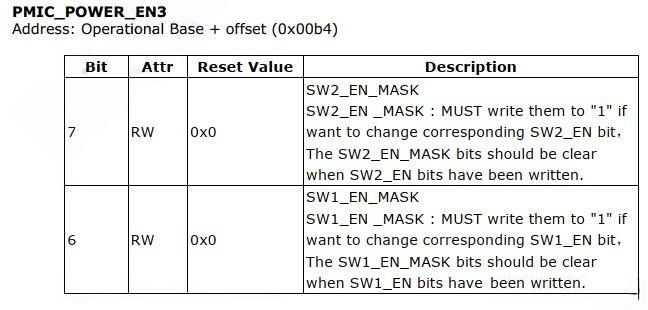
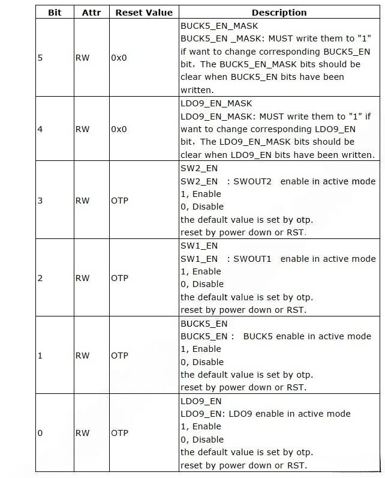

## 简介
i2ctool是嵌入式开发过程中调试i2c设备常用的工具包，其中比较常用的有：i2cdetect、i2cdump、i2cset、i2cget。
## 编译
RK平台的SDK大部分默认都会带这个工具，如果没有编译进去或者找不到的情况下可以自己从网上下载编译进去：
* 下载： https://www.kernel.org/pub/software/utils/i2c-tools
* 编译：
```bash
修改Makefile里面的配置：
1.根据开发板使用的交叉编译工具链修改交叉编译工具：
#CC     ?= gcc
#CC     := arm-linux-gnueabihf-gcc
CC      := aarch64-linux-gnu-gcc

2.修改用静态库：
BUILD_DYNAMIC_LIB ?= 0
BUILD_STATIC_LIB ?= 1
USE_STATIC_LIB ?= 0

3.执行 make 生成：
i2ctransfer i2cget i2cset i2cdump i2cdetect
```
* 下载目标文件：把生成的可执行文件拷贝到板子上。

## i2cdetect

检测有几组i2c总线在系统上：
```bash
[root@rk3399:/]# i2cdetect -l
i2c-0   i2c             rk3x-i2c                                I2C adapter
i2c-1   i2c             rk3x-i2c                                I2C adapter
i2c-4   i2c             rk3x-i2c                                I2C adapter
i2c-9   i2c             DP-AUX                                  I2C adapter
i2c-10  i2c             DesignWare HDMI                         I2C adapter
i2c-11  i2c             DP-AUX                                  I2C adapter
```
检测挂载在i2c总线上的设备(i2c0)：
```bash
[root@rk3399:/]# i2cdetect -y 0
     0  1  2  3  4  5  6  7  8  9  a  b  c  d  e  f
00:          -- -- -- -- -- -- -- -- -- -- -- -- -- 
10: UU -- -- -- -- -- -- -- -- -- -- -- UU -- -- -- 
20: UU -- -- -- -- -- -- -- -- -- -- -- -- -- -- -- 
30: -- -- -- -- -- -- -- -- -- -- -- -- -- -- -- -- 
40: -- -- -- -- -- -- -- -- -- -- -- -- -- -- -- -- 
50: -- -- -- -- -- -- -- -- -- -- -- -- -- -- -- -- 
60: -- -- -- -- -- -- -- -- -- -- -- -- -- -- -- -- 
70: -- -- -- -- -- -- -- --
```
## i2cdump
查看i2c设备所有寄存器的值(i2c-0总线，i2c地址为0x20)：
```bash
[root@rk3399:/]# i2cdump -f -y 0 0x20
No size specified (using byte-data access)
     0  1  2  3  4  5  6  7  8  9  a  b  c  d  e  f    0123456789abcdef
00: 17 40 07 21 04 21 03 00 00 00 01 01 00 80 02 00    ?@?!?!?...??.??.
10: 00 00 03 00 00 00 00 06 c8 00 00 00 00 00 00 00    ..?....??.......
20: 00 00 00 ff ff 00 00 70 00 66 00 00 00 00 00 0f    .......p.f.....?
30: 04 00 00 00 a5 00 00 00 20 ff ff 00 00 e0 0f 09    ?...?... ....???
40: 69 4c 04 58 2d 0c a5 00 00 00 00 17 00 00 17 00    iL?X-??....?..?.
50: fc 00 01 00 01 b0 04 8e 06 d0 a5 18 a5 24 01 fd    ?.?.?????????$??
60: ff ef ff 00 00 00 00 00 00 00 00 a5 ee 01 30 00    .?.........???0.
70: 03 1e 6a 88 03 1e 7c 78 a5 18 01 fd 00 f6 dc 05    ??j???|x????.???
80: 8b 25 03 6e 43 f0 00 00 00 00 00 00 00 00 00 02    ?%?nC?.........?
90: 45 7f 1f 7f f2 df b8 81 1e ff 58 1b 00 c4 09 00    E????????.X?.??.
a0: c4 09 00 00 ff 00 00 00 00 00 00 00 00 00 00 00    ??..............
b0: 00 0f 0f 0f 0f bf ef ff ff 00 64 20 20 64 1a 20    .??????...d  d? 
c0: 64 00 00 64 62 62 64 ff ff ff ff ff 0c 0c 30 30    d..dbbd.....??00
d0: 0c 0c 30 30 24 30 24 24 60 60 6c 6c 6c 6c 0b 36    ??00$0$$``llll?6
e0: 00 00 00 55 a2 c8 c5 40 00 ff 22 03 0a 80 94 0c    ...U???@.."?????
f0: c0 8c a0 40 00 40 00 86 00 dc 00 fc 00 ff 60 00    ???@.@.?.?.?..`.
```
## i2cget
查看设备单个寄存器的值(i2c-0总线，i2c地址为0x20，寄存器地址为0xa)：
```bash
[root@rk3399:/]# i2cget -f -y 0 0x20 0xa
0x01
```
## i2cset
设置设备寄存器的值(i2c-0总线，i2c地址为0x20，寄存器地址为0xa，写值0x02)：
```bash
[root@rk3399:/]# i2cget -f -y 0 0x20 0xa
0x01
[root@rk3399:/]# i2cset -f -y 0 0x20 0xa 0x02
[root@rk3399:/]# i2cget -f -y 0 0x20 0xa
0x02
```
## 使用示例
### 目标
该示例主要实现通过操作电源管理芯片的寄存器，关闭一路电源输出，本示例以RK3399板子上RK809的SWITCH_REG1为例。
### 查寄存器手册


通过RK809的芯片手册的《Chapter 5 Register Description》章节可以知道，操作SW1_EN的偏移址PMIC_POWER_EN3为0x00b4。bit[6]为写允许位，bit[2]为SW1_EN，因此，写的值为：0x44。指令为：

```bash
i2cset -f -y 0 0x20 0xb4 0x44
```
### 操作
```bash
[root@rk3399:/]# i2cget -f -y 0 0x20 0xb4 #读出当前状态
0x0f
[root@rk3399:/]# i2cset -f -y 0 0x20 0xb4 0x40 #关闭sw1
[root@rk3399:/]# i2cget -f -y 0 0x20 0xb4 #读出当前状态
0x0b
```
## 出错解决
有些i2c-tools在操作中会报错，如下：
```bash
# i2cset -f 4 0x22 0xc 0x01                                        
i2cset: mode too long (see "i2cset --help")
```
应该在最后加显示模式：
```bash
# i2cset --help                                                      
usage: i2cset [-fy] BUS CHIP ADDR VALUE... MODE


Write an i2c register. MODE is b for byte, w for 16-bit word, i for I2C block.


-f      Force access to busy devices
-y      Answer "yes" to confirmation prompts (for script use)


# i2cset -f -y 4 0x22 0xc 0x1 b
```
