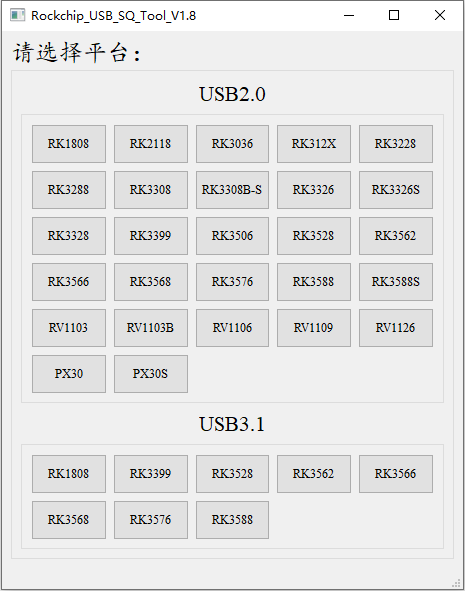
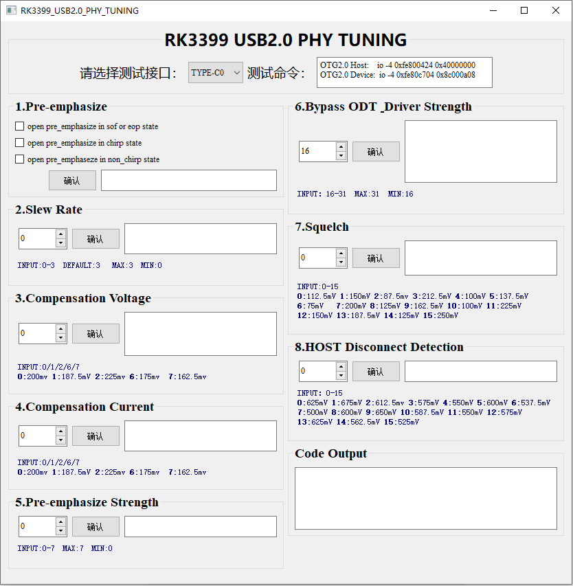
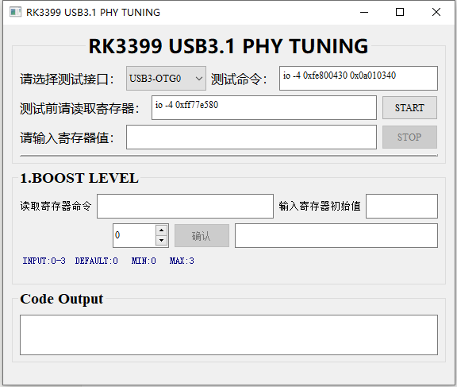
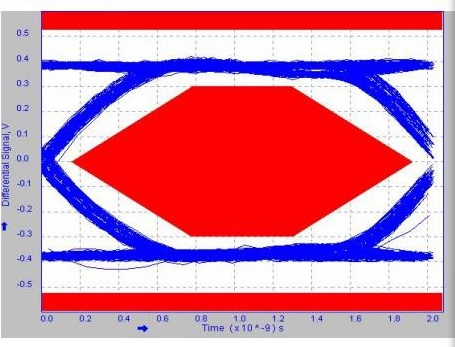

上一篇文章讲到 USB PHY 在RK平台的实际开发过程中有几种常用的调试手段，这里结合SQ_Tool说明一下。

## SQ_Tool 的诞生

在 SQ_Tool 开发出来之前，如果客户需要调试 USB PHY 的参数，譬如修改 USB 口的驱动能力，由于 RK 官方没有提供 USB PHY 的寄存器手册，一般需要客户向 RK 官方提出需求，RK 再根据客户的需求提供测试指令或者代码补丁，客户测试确认没问题再同步到自己开发的 SDK，有时候一次修改还得不到满意的结果，可能得修改好几次，调试效率非常低。为了解决这种矛盾，RK 自己开发了 SQ_Tool 专门处理这种问题，客户不需要查 USB PHY 寄存器手册就可以根据自己的需求查询到调试 USB PHY 的指令，甚至直接生成驱动代码复制到 kernel 源码中直接使用。

## SQ_Tool 的基本操作

### 获取工具

SQ_Tool 在 RK 提供的 SDK 中有可以找到，android 系统的 SDK 是在 RKTools 目录下，Linux 系统的 SDK 是在 tools 目录下，到目前为止，最新版本是 V1.8，也可以在以下路径下载到最新版本：[https://redmine.rock-chips.com/documents/113](https://redmine.rock-chips.com/documents/113)

### 运行

SQ_Tool 是 Windows 平台下的工具，免安装，解压工具包之后直接双击即可运行，运行之后可以看到该工具支持的所有芯片平台，可以根据测试需要选择。

### 调试界面

以 RK3399 的 USB2.0 调试界面为例，可以看到标题下面是选择测试接口的菜单，选择你需要调试的 USB 口即可，之后可以看到右边的测试命令会跟着变化，执行测试命令可以使 USB 口进入眼图测试模式，如果是 otg 口，指令分 device 模式和 host 模式，如果是 host 口就只有 host 模式的指令，把生成的 IO 指令拷贝到机器的调试串口或者 adb shell 终端中执行即可。

调试界面下面就是可以调试的选项，每个选项都有参数可以选，选好参数之后点“确认”，在“确认”按钮右边会生成对应的 IO 指令，把IO 指令拷贝到机器的调试串口或者 adb shell 终端中执行即可。

如果用 IO 指令测试之后可以达到满意的效果，在界面的右下角会生成一串代码，把代码添加到 USB PHY 的 tuning 函数或者 probe 函数中，确保开机的时候有调用你添加的代码，调整 USB PHY 的参数，以达到满意的效果。

以 RK3399 的 USB3.0 调试界面为例，有些调试界面需要先从板子上读取寄存器的初始值，填入寄存器值之后再开始操作界面，生成 IO 指令和代码。

## SQ_Tool 调 USB SQ

USB SQ 是指 USB 的信号质量(Signal Quality)，通过测试并调试 USB 信号质量，可以验证信号完整性，确保设备兼容性，降低误码率，提高传输效率。调节 USB SQ 具有一定的风险，不可盲目的调节，最好能测试眼图时对着眼图去适当的调节，调节到能满足需求即可，而不是调节越大越好。

### USB2.0 SQ

与 USB2.0 信号质量相关的参数有 **Pre-emphasize**、**HS Eye Height**、**Bypass ODT**、**Slew Rate** 等，RK 平台不同的主控芯片使用不同的 USB PHY，所以调节的寄存器参数也都不一样，这里只介绍最常用的几个。

**Pre-emphasize**：调预加重，可以使用 USB 信号的眼图开口会变大。

**HS Eye Height**：调节 HS 眼图幅值，默认值是 400mV。

**Bypass ODT & Driver Strength**：调节 ODT 45Ω 电阻值，输入值越大，电阻越小，眼图就越大。

**Compensation Voltage/Current**：调节电压/电流校准点，调高校准点可以提高 USB 眼图的幅度。

**Slew Rate**：主要作用是控制信号的转换速度，减少过冲，这个调节一般对眼图作用比较小。

### USB3.0 SQ

与 USB2.0 信号质量相关的参数有 **BOOST LEVEL**、**TX driver voltage**、**TX driver swing**、**TX driver preemphasis strength** 等，RK 平台不同的主控芯片使用不同的 USB PHY，所以调节的寄存器参数也都不一样，这里只介绍最常用的几个。

**BOOST LEVEL**：用于调节传输信号的强度，补偿信号在高速传输中的衰减。

**TX driver voltage**：TX 驱动器输出共模电压调节，调节TXP/TXN差分信号的共模电压。

**TX driver swing**：TX 驱动器摆幅调节。

**TX driver preemphasis strength**：TX 驱动器预加重强度调节。

## SQ_Tool 调 USB2.0 Host 断开检测阀值

USB2.0 Host 断开检测阀值即 HOST Disconnect Detection，是指 USB 主机检测到与外设的连接已被断开的一种功能（实现原理后面写文章作详细说明）。这项检测确保主机能够正确识别设备连接状态的变化，并及时进行相应的动作，例如停止数据传输、释放资源等。

在以下使用异常场景可以调 USB Host 断开检测阀值来解决。

### 无法检测USB 2.0 外设断开

当 USB Host 拔掉 USB2.0 外设无法被检测到（调试串口不会打印断开连接的日志），此时可以尝试如下步骤优化：

Step 1： 开启 EOP 的预加重（SDK 默认都是关闭 EOP 的预加重）；

Step 2： 减小 USB Host 的断开检测阈值

**注意**：

1. 有些 RK 平台主控芯片没有调节 EOP 预加重的操作，可忽略  Step 1 步骤，具体以工具页面为准；
2. 只有 Step1 操作无明显改善效果的情况下，才需要在 Step1 的基础上再做 Step 2 的操作；
3. Step 2 减小断开检测阈值存在一定的风险，如果调节过度会导致 USB 外设在正常使用中发生自动断开情况，所以用户需要自己把控风险。

### USB2.0 外设异常断开

当 USB Host 连接 USB2.0 外设在正常工作中发生异常断开（调试串口打印断开连接的日志），此时可以尝试增大 USB Host 的断开检测阈值。

**注意**：

1. 并不是所有的异常断开都是因为断开检测阈值的原因，往往更多的情况是 USB 外设自身问题或者硬件环境问题等因素导致的，所以不应该一出现此类问题就盲目的去调节断开检测阈值。
2. RK 的 SDK 默认都是关闭 EOP 的预加重的，所以此时不需要配置寄存器再去关闭该操作；
3. 增大断开检测阈值同样存在一定的风险，如果调节过度会导致 Host 无法检测到 USB 外设断开连接的情况，所以用户需要自己把控风险。

## SQ_Tool 调 USB2.0 噪声阀值

USB2.0 噪声阀值是 Squelch，指 USB 物理层对信号噪声的容忍度，即 USB PHY 层能够识别和过滤掉的最大噪声电压范围。在 USB 通信中，噪声阀值用于区分有效信号和噪声，确保数据传输过程中不会因小幅度的电压扰动或环境干扰影响信号的正确解码。

### 使用场景

当使用长度较长、质量较差、阻抗较大的USB线缆连接 High-speed 外设，无法被正常枚举 。此时可以尝试调节USB 噪声阈值。USB PHY 的噪声阈值一般默认为150 mV，当使用阻抗较大的 USB 线缆时，USB 正常信号的幅值会衰减得很厉害，甚至低于 150 mV 的，因此可能正常信号会被当作噪声处理了。此时可以适当的降低USB2.0 PHY 的噪声阈值，一般可以调节为125 mV 或者 112.5mV。

## 参考文档

本文参考了部分 RK 开发文档，包括：

《Rockchip_User_Guide_USB_PHY_Tuning_CN》

《Rockchip_Introduction_USB_SQ_Tool_CN》