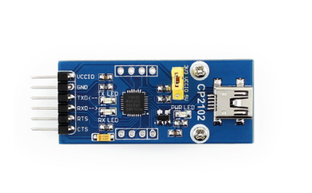
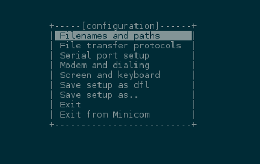
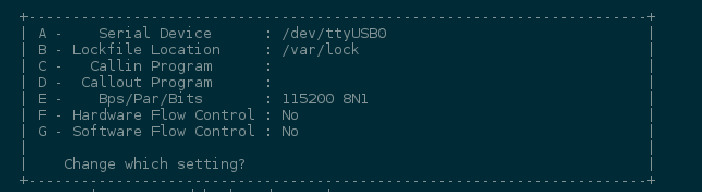

# 调试串口

调试串口在嵌入式软件开发中起着至关重要的作用，尤其是在开发、调试和维护嵌入式系统时，提供了高效、简单且可靠的调试手段。通过调试串口我们可以查看设备的状态、输出调试信息，发送控制命令来操作设备等。

### 使用场景

- 输出调试信息，查看系统启动过程的日志
- 系统崩溃后的错误信息输出，查看kernel的panic信息
- 实时调试，操作cpu和外设的寄存器
- 与上位机通信，实现数据传输，发送指令等
- 固件升级，通过调试串口升级系统固件

### 常用串口标准

常用的串口标准主要有以下几种：

- **UART**：是最常用的串口通信方式，通常用于嵌入式系统和硬件调试。
- **RS-232**：是较早的一种串口通信标准，广泛用于计算机和终端设备之间的通信。
- **RS-485**：一种差分通信标准，支持多点通信，可多个设备可以共享一条总线，适合工业自动化系统。

在嵌入式的调试过程，一般用UART来做调试串口。

### USB-to-UART适配器

由于现代电脑一般不带有原生串口接口，通常需要使用USB-to-UART适配器将电脑与开发板相连。常见的适配器芯片包括FT232、CH340、CP210x等，实物图如：



USB-to-UART适配器

### **硬件连接**

在RK平台上的开发板默认都会提供UART接口用于调试，这些接口以**TX（发送）**、**RX（接收）**、GND（地）的引脚形式暴露在开发板上，调试过程使用串口跳线（杜邦线）将开发板的调试串口连接到USB-to-UART适配器上。通常，**TX接RX**，**RX接TX**，确保地线（GND）也正确连接。将USB端的适配器连接到电脑，模块图如：


硬件连接图

### **串口参数配置**

- 波特率：1500000
- 数据位：8
- 停止位：1
- 奇偶校验：无
- 流控：无

### **Windows 上使用串口调试**

市场上的USB-to-UART适配器较多，不同的适配器需要不同的驱动软件，请安装好适配器厂商提供的驱动软件，确保Windows上能正常识别到该设备。正常识别到设备可以在Windows的设备管理器看到如下(COM24)：


Windows设备管理器界面

Windows上的串口调试工具软件很多，根据个人使用的体验，比较推荐SecureCRT和MobaXterm。

- SecureCRT
1. 安装SecureCRT

SecureCRT是付费软件，网上可以找到破解版，有条件的还是建议使用官方版本。

1. 新建会话

在工具栏中点击 “文件”，选择“快速连接”来创建一个新会话。

1. 选择连接协议和配置

在弹出的窗口中，选择 **Serial** 作为协议（串口通信协议），并选择正确的端口和串口参数配置，其中，1500000波特率需要手动输入，如果需要保存当前会话，请选择对应的选项，具体如下：


SecureCRT设置界面

1. 连接设备

如果以上步骤都正常操作，点击“连接”之后就可以连接到设备了，这时候启动机器就可以看到机器输出的日志，你可以在SecureCRT的窗口中直接输入命令，或者查看从设备传来的信息。通过右键菜单或快捷键，你还可以进行数据的复制、粘贴和保存。

- MobaXterm
1. 安装MobaXterm

从[MobaXterm 官方网站](https://mobaxterm.mobatek.net)下载并安装该软件，你可以选择免费版本，功能足够日常使用。

1. 创建串口连接

点击工具栏中的 **Session** 按钮，打开新会话窗口。

1. 选择连接协议和配置

在会话类型窗口中，选择 **Serial** 作为连接协议，并选择正确的端口和串口参数配置，其中，1500000波特率需要手动输入，具体如下：


MobaXterm设置界面

1. 连接设备

设置完成后，点击 **OK** 启动串口会话。成功建立会话后，MobaXterm会进入一个终端窗口，显示串口的实时数据传输。在此窗口中，你可以发送命令并接收设备的反馈。

### Linux 上使用串口调试

Linux上一般不需要单独安装USB-to-UART适配器的驱动，Linux上建议使用minicom。

1. 安装

`sudo apt-get install minicom` 

1. 配置

进入配置界面有两种方式：

- 使用命令：`sudo minicom -s`启动直接进入配置界面
- 使用命令：`sudo minicom`启动，再按`ctrl+a o`进入配置界面



配置界面

使用上下键选择`Serial port setup`可以设置串口相关属性，如：



minicom设置参数界面

我们只需输入上面对应的字母，就可以进如相应的菜单进行设置，设置完返回主菜单后，选择`Save setup as dfl`，将其保存为默认设置。

1. 使用

如果设置正确，使用命令：`sudo minicom`就可以启动minicom并自动打印串口信息，此时，按`ctrl+a`可以进入设置状态，在设置状态你可以：

按z键：打开帮忙菜单

按w键：自动换行

按c键：清屏

按b键：浏览历史显示

按f键：进入快速中断

按o键：进入配置菜单

按l键：把log保存

按x键：退出

1. 其他技巧

```jsx
sudo minicom -s //进入设置界面 
sudo minicom -b 1500000 //以1.5M的波特率进入 
sudo minicom -D /dev/ttyUSB1 //打开/dev/ttyUSB1 
sudo minicom -C /path/test.log //把log保存到/path/test.log 
sudo minicom -c //显示颜色
```

### 常见问题处理

1. 无输出信息

检查串口线连接是否正确（特别是Tx和Rx是否正确连接，可以尝试调换过来测试）。

确保波特率设置正确，通常为1500000，某些板卡可能是115200。

1. 乱码问题

如果出现乱码，可能是波特率配置不匹配导致的，确认设备和串口工具设置的波特率一致。

确保地线（GND）有正确连接。

换USB-to-UART适配器，有些适配器可能不支持1500000这么高的波特率。

1. 无法输入命令

检查Rx和Tx是否正确连接。

检查串口工具的参数配置，流控没关闭可能会导致无法输入命令。

尝试重启设备和串口工具。

### 总结

在嵌入式开发过程中，调试串口是非常关键的工具，尤其是在开发或调试嵌入式系统时，它为开发者提供了直接查看设备状态和交互的途径。通过正确的连接和配置，可以方便地读取启动日志、执行调试命令以及排查系统故障。